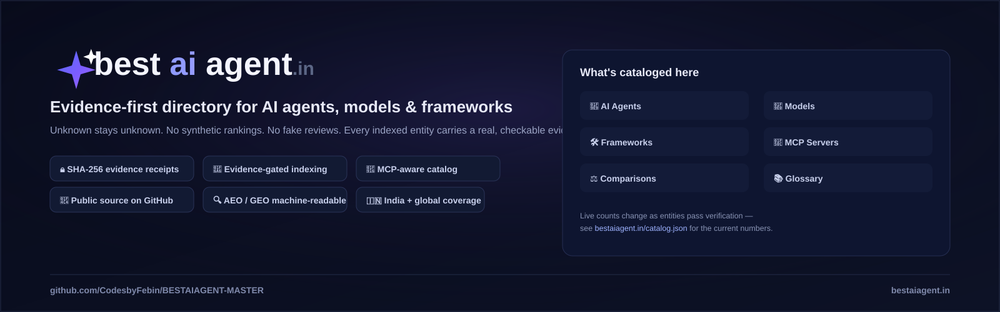
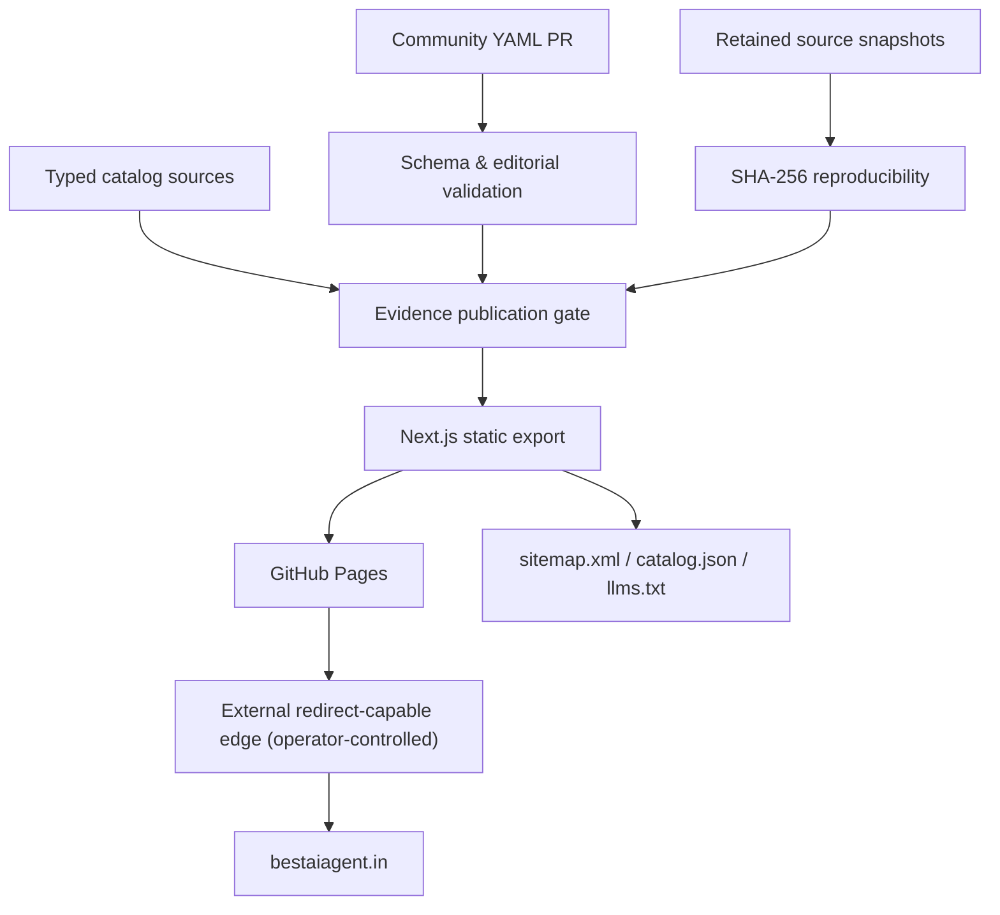

# BestAIAgent.in — Evidence-first AI Agent Directory



<div align="center">
  <strong>Evidence-first authority graph for AI agents, models, frameworks, providers, MCP infrastructure, and responsible comparisons.</strong>
  <p>Unknown stays unknown · Primary-source provenance · Static-first publication · No synthetic winners or fake reviews</p>
  <p><a href="https://bestaiagent.in">Explore the website</a> · <a href="https://bestaiagent.in/marketplace">Marketplace</a> · <a href="https://bestaiagent.in/submit">Submit a project</a> · <a href="https://bestaiagent.in/catalog.json">Catalog JSON</a> · <a href="CONTRIBUTING.md">Contribute</a></p>
</div>

## Project badges — 20 verifiable signals

[](https://nextjs.org/) [](https://react.dev/) [](https://www.typescriptlang.org/) [](https://nodejs.org/) [](https://pages.github.com/) [](https://nextjs.org/docs/app/guides/static-exports) [](https://github.com/CodesbyFebin/BEST-AI-AGENT-MASTER/actions/workflows/ci.yml) [](https://github.com/CodesbyFebin/BEST-AI-AGENT-MASTER/actions/workflows/pages.yml) [](https://github.com/CodesbyFebin/BEST-AI-AGENT-MASTER/tree/main/submissions) [](https://yaml.org/) [](https://github.com/CodesbyFebin/BEST-AI-AGENT-MASTER/blob/main/docs/EVIDENCE_POLICY.md) [](https://github.com/CodesbyFebin/BEST-AI-AGENT-MASTER/blob/main/CONTRIBUTING.md) [](https://github.com/CodesbyFebin/BEST-AI-AGENT-MASTER) [](https://bestaiagent.in) [](https://schema.org/) [](https://bestaiagent.in/sitemap.xml) [](https://bestaiagent.in/llms.txt) [](https://bestaiagent.in/robots.txt) [](https://github.com/CodesbyFebin/BEST-AI-AGENT-MASTER/tree/main/tests) [](https://github.com/CodesbyFebin/BEST-AI-AGENT-MASTER)

> Badges describe technology, implemented workflows, or declared limitations. They are not claims of independent security certification, Lighthouse scores, repository popularity, license grants, or Google indexing.

## Live GitHub widgets

[](https://github.com/CodesbyFebin/BEST-AI-AGENT-MASTER/actions/workflows/ci.yml)
[](https://github.com/CodesbyFebin/BEST-AI-AGENT-MASTER/actions/workflows/pages.yml)
[](https://github.com/CodesbyFebin/BEST-AI-AGENT-MASTER/issues)
[](https://github.com/CodesbyFebin/BEST-AI-AGENT-MASTER/pulls)
[](https://github.com/CodesbyFebin/BEST-AI-AGENT-MASTER/commits/main)
[](https://github.com/CodesbyFebin/BEST-AI-AGENT-MASTER)

These widgets query GitHub as rendered. They are diagnostics and navigation, not fabricated marketing counters; third-party badge services can temporarily fail or cache results.

## What problem does BestAIAgent.in solve?

AI agent discovery is difficult because public listings routinely mix vendor announcements, stale pricing, repository identities, independent tests, and opinionated recommendations. Those are different kinds of evidence. A repository exists, for example, but that fact alone says nothing conclusive about security, enterprise readiness, supported languages, benchmark performance, or costs. This project separates what was observed from what remains unknown.

BestAIAgent.in organizes entity identity, source provenance, thematic authority pages, research material, comparisons, and machine-readable discovery interfaces. It is deliberately not a marketplace with payments, automated purchasing, user wallets, accounts, or a hosted execution plane. The website is compiled from version-controlled source, allowing changes to be inspected through commits and pull requests.

An entry may be useful for research while still being unverified. Forcing every candidate into a “best” ranking would erase the distinction between source existence and field-level verification. Instead, the public-facing publication rules control indexability and require stronger provenance before promoting claims. Editorial decisions should be explainable, reversible, and reviewable.

This README documents the real software architecture and editorial policies. It does not assume that a green GitHub Actions workflow proves ranking success, mobile Core Web Vitals, actual search crawler behavior, uptime, a safe redirect configuration, or live Search Console indexing.

## Who should use this project?

Developers can discover coding agents, model tooling, MCP servers, agent frameworks, deployment strategies, and comparable open-source implementations. Researchers can inspect how source records were classified and how evidence was associated with an identity. Buyers can use comparison methodology to build their own evaluation matrices without receiving fabricated winners or unverifiable price quotes.

Maintainership is technical and editorial. A contributor submitting a new entry should expect a schema review, source assessment, duplicate inspection, and possible questions about license, official documentation, and exact capability claims. A source-linked project is not equivalent to one that has undergone independent adversarial testing.

The static architecture suits a directory with transparent updates and predictable deployment. It does not suit real-time individualized recommendations, private customer records, credential storage, payments, protected API access, or automated agent orchestration without an additional separately reviewed backend. Avoid describing the current website as a SaaS platform simply because marketplace pages exist.

Readers are encouraged to consult original publisher documentation when pricing, terms, laws, endpoints, model weights, or API behavior may have changed. Evidence snapshots preserve historical observations; they do not guarantee those facts remain accurate indefinitely.

## Architecture: build once, publish static artifacts

The application uses Next.js 16 App Router, React 19, TypeScript, and Node.js 22. Most source records reside under `lib/`, with route templates in `app/`, presentation modules in `components/`, public assets in `public/`, verification scripts in `scripts/`, and workflows in `.github/workflows/`. Production uses `GITHUB_PAGES_STATIC=1 npm run build` to emit an `out/` static export deployed by GitHub Pages Actions.

Static generation reduces operational dependencies but does not eliminate risk. A malicious dependency, compromised GitHub token, mistaken catalog gate, misleading JSON-LD statement, or invalid DNS redirect can still undermine trust. The repository applies build-time checks and human source review to reduce these risks, and explicitly identifies tests that are not yet independently completed.

The website does not require PostgreSQL, Redis, MongoDB, a runtime CMS, or a database migration to publish catalog updates. This is an operational characteristic, not a universal architectural prescription. A future authenticated marketplace, subscriptions service, analytics processor, or background inference worker would require new design and security decisions rather than pretending that a static host provides those functions.

The root `app/layout.tsx` sets the document language to `en-IN`. Site identity, title metadata, and canonical URL construction should use `lib/site.ts`. Pages can generate SEO metadata at build time, but those declarations must be checked against the deployed HTML and actual HTTP behavior.

## Evidence-first data doctrine

An identity record can contain its source URL, developer, entity type, categories, summary, verification state, evidence identifiers, and optional facts. These fields have different epistemic strength. A GitHub repository API response can establish the existence of a repository and selected attributes at observation time. It cannot establish a product’s marketing promises, end-user satisfaction, reliability, regulatory compliance, or commercial support.

The evidence registry records provenance such as authority class, source type, source URL, timestamp, relevant normalized snapshot, and a SHA-256 digest. The publication code determines which records are eligible for public indexing and machine-readable surfaces. Reviewers must not invent historical retrieval timestamps, snapshots, source locators, ratings, or approvals merely to satisfy a validator.

A SHA-256 digest is a fingerprint of bytes. It is not a certificate of truth, and a valid digest can faithfully represent false or incomplete source material. The offline `scripts/hash-evidence.mjs` utility recomputes hashes for retained JSON snapshots and optionally compares them with expected values. It does not retrieve a source, sign the original publication, or promote any record to verified status.

A changed upstream website does not automatically imply historical evidence fraud. Version history, retained snapshots, and capture context are needed to distinguish legitimate changes from discrepancies. Evidence freshness should be treated as a separate dimension from evidence existence. Avoid turning an expired or untested source into a current price claim.

## Publication states and indexability

The catalog distinguishes imported candidates, source-linked entities, pending review, unknown fields, and verified identities. These are not interchangeable. A newly submitted YAML document is a proposal, even if its author can point to a credible repository and its structure passes CI. Approved editorial intake does not automatically certify the project’s technical or commercial claims.

Public search indexing is controlled by catalog predicates, not by a developer adding a flag to a Markdown file. The `noindex` state is an intentional outcome for material lacking sufficient reviewed provenance. A listing can remain reachable for research or migration continuity without being advertised in the sitemap as a verified authority source.

Comparison pages have extra obligations: both entities must be appropriate for the stated use case, claim provenance must be checked, and the comparison title must match the actual subjects. Unsupported absolute winners, unobserved benchmark percentages, fabricated feature matrices, or supposedly universal scores should be rejected. “Unknown” is an acceptable and informative result.

When an old page has impressions or incoming links, changing it requires careful canonical, redirect, and editorial review. Removing an indexed URL indiscriminately can damage user navigation. Conversely, keeping every old page indexable is not evidence of content quality. The site’s migration policy should distinguish KEEP, MERGE, PRUNE, and NEEDS_EVIDENCE decisions using dated observations.

## Core topic pillars and content clusters

The site organizes discovery around AI agents, coding agents, agent frameworks, model providers, tools, MCP interoperability, pricing, alternatives, methodology, research, India-specific considerations, and glossary concepts. These are thematic pathways rather than a promise that every conceivable subtopic is already published and independently verified.

Coding-agent clusters include command-line agents, IDE assistants, local-first configurations, self-hosted approaches, and open-source workflows. MCP coverage distinguishes the protocol itself from directory entries for specific servers; a source-linked implementation is not necessarily secure to install, and any server that can execute tools, publish social posts, or access credentials requires explicit user permission.

Buyer-oriented pages focus on deployment models, procurement considerations, total cost of ownership, privacy, ability to reverse migrations, benchmark limitations, and reproducibility. The site deliberately avoids declaring a commercial winner without appropriate field-by-field evidence and a published comparison methodology.

India-oriented content considers Indic language behavior, regional hosting, enterprise constraints, billing realities, and regulatory context. “Built in India” must not be equated with Indian data residency, legal compliance, multilingual capability, or locally hosted inference. Those are distinct claims requiring separate sources.

The glossary and educational sections are useful for conceptual navigation, but research candidates should not be represented as confirmed Google-indexed pages. Editorial draft records remain outside the verified public index until source checks, canonical review, and publication gates permit release.

## Navigating the website

Start with the homepage for overall scope and current featured research surfaces. Use `/agents`, `/models`, `/frameworks`, and `/providers` for typed discovery. Explore `/mcp` and `/mcp/servers` for interoperability concepts and source-linked server records. Visit `/coding-agents` for dedicated engineering-workflow clusters.

The `/marketplace` page presents existing catalog discovery alongside community submission records that have completed editorial acceptance. The `/submit` page explains how to fork the repository and open a GitHub PR. Neither page currently provides purchasing, payment processing, subscriptions, user authorization, escrow, or agent deployment.

Research routes include `/compare`, `/alternatives`, `/pricing`, `/research`, `/guides`, `/tutorials`, `/glossary`, `/india`, and trust and methodology pages. Some dynamic entity or educational routes intentionally return `noindex`. Visible content and canonical metadata should be checked on the final compiled site rather than inferred from template names alone.

Machine-readable interfaces include `/catalog.json`, selected per-type JSON slices, `/llms.txt`, `/llms-full.txt`, `/robots.txt`, and the single `/sitemap.xml`. The search index at `/api/search/` is a static JSON artifact, not an always-on backend service. Search filtering occurs in the browser against the exported data.

## SEO: canonical, crawlability, and technical hygiene

The canonical origin configured in `lib/site.ts` is `https://bestaiagent.in`, without `www`. Every generated absolute URL should agree with that choice, including sitemap entries, Open Graph URLs, JSON-LD references, machine-readable files, and internal canonical links. This is a source-code requirement; actual network behavior requires independent HTTP checks.

GitHub Pages cannot execute arbitrary Next.js request-time redirects or custom response headers. A `www` to apex permanent redirect requires a redirect-capable external edge configuration if both hostnames are exposed. The repository provides `scripts/verify-apex-redirect.sh` to check ten important paths and query-string preservation, and `npm run audit:live-hosts` for broader sampling. Passing a static build does not prove either rule is active.

The sitemap should list only canonical, indexable URLs that satisfy the publication gates. This repository currently targets one flat apex sitemap. A future shard feature is intentionally disabled until a reviewed migration has evidence that shard indexing is valid. Do not create fake sitemap aliases, dateModified values, or lastmod timestamps solely to influence crawlers.

Technical SEO includes HTTP availability, mobile legibility, stable layouts, accessible headings, meaningful navigation, sensible metadata, and correct duplicate handling. Search Console coverage, search impressions, real-user Core Web Vitals, and ranking changes are external measurements. They must not be replaced with fabricated scores in README badges or documentation.

## AEO: useful answers without answer-engine theater

Answer engine optimization begins with answering a real question accurately and compactly, then supplying enough context that readers can evaluate the limits. A heading phrased as a question is helpful only if the following answer resolves it. Artificially forcing every section to contain an arbitrary word count can reduce clarity and obscure what the evidence actually establishes.

Entity pages should explain what a project is, what source established its identity, what is known about its implementation, what remains unknown, and how it differs from nearby alternatives. The best direct answer depends on the available evidence; it may be two sentences rather than a fixed-length paragraph. A statement of unknown pricing is better than an invented free tier.

Structured data should accurately match visible content and the selected Schema.org types. BreadcrumbList is useful when a real navigational hierarchy exists. Article and SoftwareApplication have distinct intended meanings. FAQPage should not be added mechanically or used to invent unsupported Q&A claims. Google's rich-result policies and eligibility can change, so markup validation is not a guarantee of search presentation.

Users should be able to inspect original primary sources. Dates should describe real observations, not convenient build timestamps. AEO success is better measured through validated factual answers, usable pages, and independently observed referral behavior than through an internal “AEO score” with no published methodology.

## GEO: evidence-backed generative discovery

Generative engine optimization is not a replacement for trustworthy content. A system may cite a page because it is crawlable, clearly structured, relevant to the question, and supported by primary sources. Citation behavior varies across products, retrieval settings, geographic markets, and time. This repository does not guarantee inclusion in AI answers.

The `llms.txt` endpoint is emitted by the Next.js static route at `app/llms.txt/route.ts`. It should reference the same apex canonical and verified public records as the HTML site. Do not create a duplicate `public/llms.txt` with competing values. The extended `llms-full.txt` should remain aligned to publicly indexable entities, not all internal imported candidates.

AI crawler settings in robots.txt express crawl policy but do not compel any crawler to fetch, quote, or rank the site. The strongest general approach is to make direct answers easy to retrieve, keep source links and visible uncertainty clear, and avoid publishing unverifiable numerical claims just because generative systems may prefer statistics.

Citation monitoring should separate model-generated mentions, linked citations, attributed source URLs, referral traffic, and human conversions. Sampling should be documented, repeatable where possible, and transparent about non-determinism. Third-party discussion and public contributions must be authentic; astroturfing, planted testimonials, and misleading community posts undermine the evidence doctrine.

## Trust, corrections, and accessibility

Trust is a process, not a styling choice. Trust and methodology pages should explain how identity receipts are recorded, what reviewers are actually confirming, how disagreements are handled, which attributes remain untested, and what conditions would cause a published record to be corrected or quarantined.

An update to a source snapshot should preserve the historical rationale when feasible. Corrections should identify the affected entry, what changed, when the source was reviewed, and whether any ranking or indexability consequence followed. A changelog is useful only when it contains real changes; generated timestamps on unchanged pages must not imply fresh human review.

Accessible navigation is part of quality. Screens should have meaningful titles, a discoverable main region, link text that explains destinations, visible keyboard focus, adequate contrast, and responsive layouts. Automated linting catches some issues, but full accessibility requires keyboard, screen-reader, and representative browser checks.

Security disclosures should not claim independent audit completion unless there is a dated, scoped report. A static site does not accept user sessions today, but repository write permissions, CI dependencies, and source material remain attack surfaces. External marketplace submissions and MCP links should be treated as untrusted until inspected.

## Local setup and reproducible build

Use a Node.js 22 environment with npm. Clone the repository, install dependencies from `package-lock.json` with `npm ci`, and start development using `npm run dev`. Development mode is useful for layout iteration but is not proof of static-export compatibility. The definitive build target is `GITHUB_PAGES_STATIC=1 npm run build`.

The `npm run verify` command aggregates unit tests, submission validation, catalog checks, crawl graph checks, GSC migration checks, quarantine, publication integrity, methodology, freshness, editorial checks, GitBook inventory, TypeScript typecheck, lint, build, and JSON-LD validation. Inspect `package.json` before assuming a script's exact scope or availability.

Native Node tests are stored under `tests/`. Validation scripts include both fail-closed checks and deliberately limited checks, depending on the assertion being tested. `verify:gitbook-release` is a strict chapter-import gate and may fail until the complete editorial assets are present; passing the standard workflow does not imply every planned book chapter has been released.

For a source-based evidence exercise, create a retained JSON snapshot and use `node scripts/hash-evidence.mjs snapshot.json` to calculate its digest. To check a known digest, pass `--verify sha256:<digest>`. Keep that result separate from editorial approval, source freshness, and independent validation of claims.

## GitHub PR submission workflow

Submissions are Git-native to make provenance and review visible in version history. A developer forks the project, copies `submissions/TEMPLATE.yaml` into the matching category folder, supplies a public upstream repository and honest project details, then opens a pull request. Categories include agents, bots, models, skills, MCP servers, and frameworks.

The validator checks structural requirements such as category directory, matching slug, field types, public URLs, version formatting, duplicate entries, and evidence-hash formatting. It is not a reputation score, browser security scanner, software bill of materials, legal review, or proof that marketing claims are true. A developer must not fill unknown fields with invented estimates merely to pass the check.

All new submissions start pending. A maintainer can request corrections, source links, or better scope descriptions. Any later editorial approval should be recorded in Git history with a rationale, and should not be presented as full independent verification. Paid listing prioritization and featured placement are not currently implemented in the website.

Reviewers should look for license mismatches, false upstream ownership, untrusted redirects, unsafe installation commands, secret collection, exaggerated AI capability claims, and duplicate projects under different names. For MCP servers capable of state-changing actions, credentials and exact human authorization matter even when the GitHub repository itself is public.

## CI and release discipline

GitHub Actions runs the standard quality pipeline on pushes and pull requests, and a separate Pages workflow publishes the static export. A successful PR build provides meaningful build evidence for that exact commit, but deployment and live behavior should be checked after the resulting merge commit triggers main-branch workflows.

Before merging, reviewers should inspect changed routes, data gates, sitemap differences, machine-readable output, and JSON-LD. A PR that modifies canonical origin, redirect policies, robots.txt, or indexing predicates carries wider risk than a prose-only documentation change. Verify the consequences, not merely the TypeScript syntax.

The optional Lighthouse job is controlled by a repository variable and is not automatically enabled. A laboratory Lighthouse run does not measure real-user INP at the seventy-fifth percentile. Performance budgets should be based on actual mobile and field measurements where available. Do not present a disabled audit as a passed benchmark.

Deployment can succeed while DNS remains wrong. GitHub Pages build status does not confirm Cloudflare redirect activation, apex custom-domain validation, Search Console ownership, indexing, or search visibility. The documentation distinguishes code correctness, build qualification, deployment success, and external operational verification as separate gates.

## Content freshness and editorial lifecycle

AI software changes rapidly, so timestamps and status need precise meaning. A repository may still exist while its release channel, dependencies, hosted availability, API pricing, or security posture changes substantially. Freshness should be reviewed per claim and source type, not inferred from the latest website deployment date.

For example, a repository-identity receipt may remain historically accurate after a model vendor revises subscription plans. The original receipt should not be silently extended to certify the new price. Likewise, an imported glossary definition should not be described as independently source-verified simply because a static page was generated from it.

A healthy editorial process identifies changed upstream records, checks which assertions depend on them, preserves the original observation when possible, and requests review before modifying public classification. Automated checks can create a candidate task; they should not fabricate a new source snapshot or mark an unknown value as verified to keep dashboards green.

The public changelog may describe important releases, but the true provenance remains in the Git commit history and associated review discussions. Readers should be told plainly when an old record was last observed and which dimensions still require refresh or manual inspection.

## Operator runbooks and outstanding gates

The canonical `https://bestaiagent.in` is specified in source. An external redirect-capable edge must enforce `www.bestaiagent.in` to apex with a permanent HTTP status, path preservation, and query preservation when both hostnames are active. The repository's shell test checks that expected behavior, but cannot create a Cloudflare account-level rule.

Search Console property ownership and sitemap submission are administrative actions. They require the right verified apex or Domain property and later dated index-coverage evidence. Historic figures such as 925 indexed and 509 discovered-but-not-fetched should never become timeless progress badges. The latest GSC exports need their property, observation dates, and URLs identified.

The current sitemap is a single flat export. A feature-flagged sitemap split is not active. Legacy migration mappings may need real HTTP 301/308 handling at the edge rather than Next.js redirects, because GitHub Pages cannot execute arbitrary server redirect behavior.

External publication gaps include a verified redirect chain, index-coverage follow-up, real Core Web Vitals, an independent accessibility review, and full GitBook chapter qualification. These do not block someone from reading the static directory today, but they do block claims that the release has achieved complete SEO/GEO recovery or an independently certified 100/100 score.

## Repository licensing and responsible reuse

This repository does not currently declare a repository-wide software license. Publishing source on GitHub does not grant everyone an automatic MIT or Apache license. Contributors and reusers must follow actual upstream license terms, and third-party entity catalogs, screenshots, logos, documentation, and snapshots may carry their own rights and attribution conditions.

A maintainer may later choose an appropriate license after considering ownership and imported material. That choice should be explicit. It is not correct to add a popular license solely to make a badge green or satisfy a generic README checklist. Documentation should preserve this limitation until the rights holder authorizes a change.

Security reports and correction requests should provide reproducible steps, affected routes, source links, and expected versus observed behavior. Do not place secrets, private customer data, API tokens, personal records, or exploit payloads in public issues. Use GitHub's responsible disclosure capabilities when a report could materially expose users or infrastructure.

A public repository is an invitation to review and contribute under the stated process. It is not a guarantee of permission to redistribute all assets, republish third-party claims, mirror an API feed, or commercially sublicense the collection. License documentation should make those distinctions visible instead of relying on implied consent.

## Frequently asked questions

**Is BestAIAgent.in a SaaS service?** No. It is currently a GitHub Pages static catalog with build-time content and a PR-based community intake. Accounts, paid marketplace transactions, and remote agent execution are not part of the published architecture.

**Does a verified identity mean the agent is secure?** No. Identity provenance is narrower than security, reliability, performance, pricing, or regulatory compliance. Those claims require specific independent evidence.

**Can a developer submit a model or MCP server?** Yes. Follow the YAML template, use a matching category directory, provide public sources, and open a GitHub pull request. Passing schema validation does not guarantee publication.

**Is there an official “best” ranking?** The project explicitly rejects unsupported synthetic ranking and arbitrary winners. Comparison pages should show the tested dimensions and distinguish supported facts from unknown outcomes.

**Does the sitemap include every project ever imported?** No. Indexable URL selection follows publication policy. Historical or editorial pages may remain `noindex`.

**Why keep llms.txt?** It offers a machine-readable orientation to the catalog. It is not a search ranking guarantee or proof that any language model uses that file.

**Does the website store user search history?** The architecture performs search filtering in the browser against a static exported index. Do not infer from that alone that all analytics, third-party requests, or browser telemetry are absent.

**Can I rely on pricing as current?** Only when a claim has appropriately dated primary-source support. Unknown, untested, or stale commercial fields must be treated as needing vendor confirmation.

**How are corrections handled?** Via source reviews, version-controlled changes, and publication checks. A disputed claim should not stay marked verified simply because it previously passed structural validation.

**Is the code MIT-licensed?** No repository-wide license is declared today. Ask the maintainer before reuse beyond the applicable default rights.

**Will static pages automatically rank well?** No. HTTP availability, content quality, user demand, correct canonicals, source credibility, crawlability, and external indexing all matter independently.

**What should I inspect first?** The publication doctrine, typed catalog records, actual evidence snapshots, verification scripts, GitHub Actions workflow, and current deployment settings.

## Architecture at a glance



## Common CLI commands

```bash
gh repo clone CodesbyFebin/BEST-AI-AGENT-MASTER
cd BEST-AI-AGENT-MASTER
npm ci
npm run test:unit
npm run verify:submissions
npm run verify
GITHUB_PAGES_STATIC=1 npm run build
bash scripts/verify-apex-redirect.sh
npm run audit:live-hosts -- host-audit.json
gh run list --limit 10
```

## Companion project: Agentic Marketplace

**[CodesbyFebin/Agentic-Marketplace](https://github.com/CodesbyFebin/Agentic-Marketplace)** is the separately maintained, public companion repository for a future agentic marketplace ecosystem. It is a distinct project, not the current BestAIAgent.in deployment. At the time of linking, the companion repository contains no published implementation files; marketplace transactions, agent execution, subscriptions, authentication, and integration APIs must not be described as shipped or wired to this directory.

The intended relationship is complementary: **BestAIAgent.in** provides evidence-conscious discovery, source provenance, canonical entity data, and GitHub PR submissions, while the companion project may evolve its own marketplace capabilities under independent architecture, security, licensing, and release review. Links between repositories establish navigation, not a shared database, verified synchronization protocol, or guarantee of feature parity.

[Visit Agentic Marketplace on GitHub](https://github.com/CodesbyFebin/Agentic-Marketplace) · [Explore BestAIAgent.in](https://bestaiagent.in/marketplace) · [Submit a directory entry](https://bestaiagent.in/submit)

## Release, publication, and GitHub discoverability

This is a **publicly readable, source-available repository**. A repository-wide open-source license is **not declared**, so the site must not carry an OSI-approved or MIT badge until the copyright holder makes an explicit license decision. GitHub releases can publish tagged versions of the source, but publishing a release does not itself grant redistribution rights. A public catalog listing is not an endorsement, source-level security audit, or warranty.

Releases should use semantic version labels when they correspond to reviewed changes. Each release note should identify the commit, passed GitHub Actions workflows, static-export result, important catalog/evidence policy modifications, redirects affected, and separately pending operational gates. Do not describe a source archive as a deployed live release unless the production Pages run for the same commit completed successfully.

Suggested GitHub Topics: `ai-agents`, `ai-directory`, `ai-models`, `ai-frameworks`, `mcp`, `model-context-protocol`, `nextjs`, `typescript`, `react`, `github-pages`, `static-site`, `seo`, `answer-engine-optimization`, `generative-ai`, `ai-tools`, `structured-data`, `knowledge-graph`, `evidence-based`, `source-available`, `developer-tools`. Topics are search metadata, not independent quality certifications. Avoid `vercel` and `open-source` unless their meanings match a verified deployment or license.

### How to publish a source release

After required CI checks and deployment qualification, maintainers can run:

```bash
gh auth status
gh repo set-default CodesbyFebin/BEST-AI-AGENT-MASTER
git checkout main && git pull --ff-only origin main
gh run list --branch main --limit 5
git tag -a v2.1.0-docs -m "BestAIAgent.in documentation and publication baseline"
git push origin v2.1.0-docs
gh release create v2.1.0-docs --repo CodesbyFebin/BEST-AI-AGENT-MASTER --title "BestAIAgent.in — Documentation and Publication Baseline" --notes-file docs/RELEASE-PUBLICATION-GUIDE.md --verify-tag
```

Use a new tag only once; confirm the latest GitHub release/tag before executing these sample commands. A GitHub source release is not a package-registry publication, paid product offering, signed binary, or search-engine indexing event. The GitHub CLI commands are for a maintainer with write permission; they are not automatically executed by this README.

## Maintainer and review navigation

| Concern | Primary file or directory |
| --- | --- |
| Site canonical identity | `lib/site.ts` |
| Next.js pages | `app/` |
| Typed entity catalog | `lib/entities.ts`, `lib/catalog.ts` |
| Source evidence | `lib/evidence.ts`, `data/authority-evidence.json` |
| Community submissions | `submissions/`, `scripts/validate-submission.mjs` |
| Evidence reproducibility | `scripts/hash-evidence.mjs` |
| Build publication checks | `scripts/verify-*.mjs` |
| Apex host tests | `scripts/verify-apex-redirect.sh`, `scripts/audit-live-hosts.mjs` |
| GitHub Pages deployment | `.github/workflows/pages.yml` |
| Editorial policy | `CONTRIBUTING.md`, `AGENTS.md` |
| GSC readiness and triage | `docs/` |
| Documentation import gates | `scripts/verify-gitbook-inventory.mjs` |


## Maintainer, discoverability and project relationships

**Project owner and featured maintainer:** [CodesbyFebin](https://github.com/CodesbyFebin). See [AUTHORS.md](AUTHORS.md) for the authorship distinction; GitHub's Contributors graph is generated from actual commit history and may include automation accounts. This project does not hide or rewrite that history.

**Companion reference:** [CodesbyFebin/Agentic-Marketplace](https://github.com/CodesbyFebin/Agentic-Marketplace). This is an independent companion repository, not an existing referral commission network, deployed marketplace API, or guaranteed income mechanism.

**GitHub discovery:** [Citation metadata](CITATION.cff) · [Machine-readable index guide](docs/wiki/AI-MACHINE-READABLE.md) · [Discovery and ethical referral policy](docs/wiki/DISCOVERY-AND-REFERRALS.md) · [Engineering wiki](docs/wiki/README.md) · [Security policy](SECURITY.md).

Public source availability is **not** an open-source license grant. No fake stars, artificial ranking, fabricated contributor identities, keyword stuffing, or undisclosed promotional links.

## Engineering wiki, governance and automation

The [14,000+ word Engineering, Governance and Operations Wiki](docs/wiki/ENGINEERING-OPERATIONS-HANDBOOK.md) describes code and planning agents, review policies, GitHub webhooks, runner and Internet access constraints, OIDC federation, protected environments, branch rulesets, MCP server controls, cloud deployment, evidence and licensing. The [Security Policy](SECURITY.md) supports responsible disclosure, and [CODEOWNERS](.github/CODEOWNERS) identifies the proposed review owner.

**Operational distinction:** a documentation policy or CODEOWNERS file does not automatically configure repository rulesets, third-party OAuth providers, webhook receivers, cloud identities or GitHub environment protection. Those operator-only settings require separate authorization and verification. The repository remains publicly readable and source-available; no license has been selected.

## Contribution, support, and attribution

See [CONTRIBUTING.md](CONTRIBUTING.md) for the precise evidence and reviewer contract, [AGENTS.md](AGENTS.md) for engineering boundaries, and [submissions/README.md](submissions/README.md) for the developer intake workflow. Start with a focused issue or pull request rather than pushing unsupported catalog facts. Source disagreements are reviewable questions, not opportunities to make the validator less strict.

**Live site:** https://bestaiagent.in · **Repository:** https://github.com/CodesbyFebin/BEST-AI-AGENT-MASTER · **Issues:** https://github.com/CodesbyFebin/BEST-AI-AGENT-MASTER/issues

**License:** No repository-wide license has been declared. Rights and permissions must be confirmed by the copyright holders before redistribution.

---

*Built to make uncertainty explicit. Evidence before promotion. Source-backed answers before marketing claims.*
