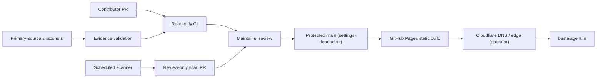

# BestAIAgent.in — Engineering, Governance, Automation and Operations Wiki
> **Scope:** GitHub-native handbook for `CodesbyFebin/BEST-AI-AGENT-MASTER`. This is a versioned wiki-style handbook stored in the repository; GitHub's separate wiki feature is not automatically populated by this file.
>
> **Truth boundary:** Documentation is a proposed operating standard, not proof that GitHub repository rulesets, Cloudflare redirects, cloud OIDC, paid runners, webhook endpoints, protected environments or secrets have been configured. The published app is a Next.js 16 static export on GitHub Pages with apex `https://bestaiagent.in`.

## Navigation

1. [Architecture and scope](#architecture-and-scope)
2. [Planning and decision records](#planning-and-decision-records)
3. [Planning agents and suggestions](#planning-agents-and-suggestions)
4. [Code review](#code-review)
5. [Branch protection and rulesets](#branch-protection-and-rulesets)
6. [Webhook integration](#webhook-integration)
7. [Actions runners](#actions-runners)
8. [OIDC federation](#oidc-federation)
9. [Environment protection](#environment-protection)
10. [Workflow permissions](#workflow-permissions)
11. [Marketplace submissions](#marketplace-submissions)
12. [Evidence and hashing](#evidence-and-hashing)
13. [MCP server policy](#mcp-server-policy)
14. [Network and internet access](#network-and-internet-access)
15. [Cloud deployment](#cloud-deployment)
16. [Secrets management](#secrets-management)
17. [Dependency security](#dependency-security)
18. [Security scanning](#security-scanning)
19. [SEO and canonical policy](#seo-and-canonical-policy)
20. [Search Console operations](#search-console-operations)
21. [AEO GEO editorial strategy](#aeo-geo-editorial-strategy)
22. [Accessibility and performance](#accessibility-and-performance)
23. [Repository releases](#repository-releases)
24. [Licensing](#licensing)
25. [Incident response](#incident-response)
26. [Monitoring and audit ledger](#monitoring-and-audit-ledger)

## System boundary diagram



## Operating model

The website is a content publication system, not a background coding-agent execution service. Code, documentation, and marketplace intake use Git as the durable transaction log. All changes should have a pull request, reviewable diff, exact commit, deterministic build and explicit owner for live external operations. External tools are optional and must be configured only after narrow authorization. A tool capable of deployment or repository mutation is a privileged dependency and should not be conflated with a content-directory listing.

The companion project [CodesbyFebin/Agentic-Marketplace](https://github.com/CodesbyFebin/Agentic-Marketplace) is separate; cross-linking repositories does not establish production synchronization, shared billing, working agent marketplace API or package publishing. An implementation proposal in an attached document remains a proposal unless the corresponding repository and tests substantiate that feature.

## 1. Architecture and scope

**Present state and scope.** Static Next.js 16 export. The engineering objective here is gitHub Pages and apex canonical. This section is a working standard for future maintainers rather than a claim that each permission, tool, service, or dashboard setting is currently enabled. Every related change should name its specific repository path, source of evidence, reviewed diff, and intended downstream effect. Preserve the current build-time publishing boundary unless there is an explicit architectural proposal and independent verification.

**Design and planning contract.** Open a focused GitHub Issue that records motivation, measurable success criteria, affected files, and known constraints. Document which activity the proposed automation is permitted to perform and what it must not touch. Break large changes into small pull requests that can be reverted safely, favoring read-only discovery and clear source classification before any write operation. GitHub Pages and apex canonical. When the design requires a paid cloud service, an external account, or sensitive credentials, mark it blocked until the operator supplies verified authority and a zero-surprise billing policy.

**Security, misuse, and authorization.** Do not silently introduce a runtime queue, SQL database, paid marketplace or credential-bearing backend. Also guard against crafted YAML, malicious PR instructions, compromised dependency updates, poisoned repository content, unsafe shell interpolation, and source URLs pointing at sensitive hosts. A developer recommendation is not equivalent to an authorization token. The default role should read source, produce an artifact, and request review; writes need narrower grants, approval, logging, and an explicit rollback procedure. Any ambiguous setting must fail closed and be documented as unknown rather than inferred from an adjacent workflow.

**Implementation and verification path.** Confirm generated HTML, sitemap, catalog JSON and llms.txt derive from reviewed source records. For implementation, require a named owner, a testable artifact, and a documented separation between local CI evidence and network-visible operational behavior. Include negative tests: revoked credentials, wrong branch or environment, malicious user-controlled inputs, rate-limited network responses, partial outages, and missing repository rights. Prefer reproducible scripts that print meaningful nonzero exit codes. Avoid workflows that print green status for skipped checks or substitute a mock response for a live integration test.

**Review and publication quality.** A human reviewer should inspect whether the change preserves entity evidence gates, existing noindex controls, single apex sitemap behavior, and uncertainty labels. The reviewer must distinguish syntax correctness, successful build, runtime availability, business value, and security assurance. Document unresolved concerns in the PR description and decline unsupported score claims. If a check needs a Cloudflare console, GSC property, GitHub ruleset or billing account, treat it as an operator gate rather than pretending source code can implement it.

**Runbook, observability, and rollback.** Before publishing, capture the before-state, targeted scope, and the smallest viable safe rollback. After deployment, collect a dated external observation and compare it with expected behavior. Store only metadata necessary for diagnosis; redact tokens and personally identifying material from logs. Incident response should restore safe configuration first and investigate with reproducible evidence afterward. Any recommendation can be deferred or rejected without breaking the static site, because the default architecture has no runtime orchestration requirement.


## 2. Planning and decision records

**Present state and scope.** GitHub Issues, milestones and PR descriptions. The engineering objective here is a change proposal with owner, acceptance tests, risks, evidence and rollback. This section is a working standard for future maintainers rather than a claim that each permission, tool, service, or dashboard setting is currently enabled. Every related change should name its specific repository path, source of evidence, reviewed diff, and intended downstream effect. Preserve the current build-time publishing boundary unless there is an explicit architectural proposal and independent verification.

**Design and planning contract.** Open a focused GitHub Issue that records motivation, measurable success criteria, affected files, and known constraints. Document which activity the proposed automation is permitted to perform and what it must not touch. Break large changes into small pull requests that can be reverted safely, favoring read-only discovery and clear source classification before any write operation. A change proposal with owner, acceptance tests, risks, evidence and rollback. When the design requires a paid cloud service, an external account, or sensitive credentials, mark it blocked until the operator supplies verified authority and a zero-surprise billing policy.

**Security, misuse, and authorization.** Do not mistake a model-generated plan for authorization to ship a feature. Also guard against crafted YAML, malicious PR instructions, compromised dependency updates, poisoned repository content, unsafe shell interpolation, and source URLs pointing at sensitive hosts. A developer recommendation is not equivalent to an authorization token. The default role should read source, produce an artifact, and request review; writes need narrower grants, approval, logging, and an explicit rollback procedure. Any ambiguous setting must fail closed and be documented as unknown rather than inferred from an adjacent workflow.

**Implementation and verification path.** Track blocked Cloudflare, GSC, license and field performance gates as independent operator tasks. For implementation, require a named owner, a testable artifact, and a documented separation between local CI evidence and network-visible operational behavior. Include negative tests: revoked credentials, wrong branch or environment, malicious user-controlled inputs, rate-limited network responses, partial outages, and missing repository rights. Prefer reproducible scripts that print meaningful nonzero exit codes. Avoid workflows that print green status for skipped checks or substitute a mock response for a live integration test.

**Review and publication quality.** A human reviewer should inspect whether the change preserves entity evidence gates, existing noindex controls, single apex sitemap behavior, and uncertainty labels. The reviewer must distinguish syntax correctness, successful build, runtime availability, business value, and security assurance. Document unresolved concerns in the PR description and decline unsupported score claims. If a check needs a Cloudflare console, GSC property, GitHub ruleset or billing account, treat it as an operator gate rather than pretending source code can implement it.

**Runbook, observability, and rollback.** Before publishing, capture the before-state, targeted scope, and the smallest viable safe rollback. After deployment, collect a dated external observation and compare it with expected behavior. Store only metadata necessary for diagnosis; redact tokens and personally identifying material from logs. Incident response should restore safe configuration first and investigate with reproducible evidence afterward. Any recommendation can be deferred or rejected without breaking the static site, because the default architecture has no runtime orchestration requirement.


## 3. Planning agents and suggestions

**Present state and scope.** Read-only assistance in issue drafting, PR review checklists and failure triage. The engineering objective here is human selects which suggestions become actionable changes. This section is a working standard for future maintainers rather than a claim that each permission, tool, service, or dashboard setting is currently enabled. Every related change should name its specific repository path, source of evidence, reviewed diff, and intended downstream effect. Preserve the current build-time publishing boundary unless there is an explicit architectural proposal and independent verification.

**Design and planning contract.** Open a focused GitHub Issue that records motivation, measurable success criteria, affected files, and known constraints. Document which activity the proposed automation is permitted to perform and what it must not touch. Break large changes into small pull requests that can be reverted safely, favoring read-only discovery and clear source classification before any write operation. Human selects which suggestions become actionable changes. When the design requires a paid cloud service, an external account, or sensitive credentials, mark it blocked until the operator supplies verified authority and a zero-surprise billing policy.

**Security, misuse, and authorization.** Never give a planning assistant repository write credentials by default. Also guard against crafted YAML, malicious PR instructions, compromised dependency updates, poisoned repository content, unsafe shell interpolation, and source URLs pointing at sensitive hosts. A developer recommendation is not equivalent to an authorization token. The default role should read source, produce an artifact, and request review; writes need narrower grants, approval, logging, and an explicit rollback procedure. Any ambiguous setting must fail closed and be documented as unknown rather than inferred from an adjacent workflow.

**Implementation and verification path.** Agent output must label sourced facts, hypotheses, unknowns and proposed commands. For implementation, require a named owner, a testable artifact, and a documented separation between local CI evidence and network-visible operational behavior. Include negative tests: revoked credentials, wrong branch or environment, malicious user-controlled inputs, rate-limited network responses, partial outages, and missing repository rights. Prefer reproducible scripts that print meaningful nonzero exit codes. Avoid workflows that print green status for skipped checks or substitute a mock response for a live integration test.

**Review and publication quality.** A human reviewer should inspect whether the change preserves entity evidence gates, existing noindex controls, single apex sitemap behavior, and uncertainty labels. The reviewer must distinguish syntax correctness, successful build, runtime availability, business value, and security assurance. Document unresolved concerns in the PR description and decline unsupported score claims. If a check needs a Cloudflare console, GSC property, GitHub ruleset or billing account, treat it as an operator gate rather than pretending source code can implement it.

**Runbook, observability, and rollback.** Before publishing, capture the before-state, targeted scope, and the smallest viable safe rollback. After deployment, collect a dated external observation and compare it with expected behavior. Store only metadata necessary for diagnosis; redact tokens and personally identifying material from logs. Incident response should restore safe configuration first and investigate with reproducible evidence afterward. Any recommendation can be deferred or rejected without breaking the static site, because the default architecture has no runtime orchestration requirement.


## 4. Code review

**Present state and scope.** Branch-based review with CODEOWNERS and required status checks. The engineering objective here is review source truthfulness as well as lint and TypeScript. This section is a working standard for future maintainers rather than a claim that each permission, tool, service, or dashboard setting is currently enabled. Every related change should name its specific repository path, source of evidence, reviewed diff, and intended downstream effect. Preserve the current build-time publishing boundary unless there is an explicit architectural proposal and independent verification.

**Design and planning contract.** Open a focused GitHub Issue that records motivation, measurable success criteria, affected files, and known constraints. Document which activity the proposed automation is permitted to perform and what it must not touch. Break large changes into small pull requests that can be reverted safely, favoring read-only discovery and clear source classification before any write operation. Review source truthfulness as well as lint and TypeScript. When the design requires a paid cloud service, an external account, or sensitive credentials, mark it blocked until the operator supplies verified authority and a zero-surprise billing policy.

**Security, misuse, and authorization.** A green CI run does not establish that a submission is authentic or licensed. Also guard against crafted YAML, malicious PR instructions, compromised dependency updates, poisoned repository content, unsafe shell interpolation, and source URLs pointing at sensitive hosts. A developer recommendation is not equivalent to an authorization token. The default role should read source, produce an artifact, and request review; writes need narrower grants, approval, logging, and an explicit rollback procedure. Any ambiguous setting must fail closed and be documented as unknown rather than inferred from an adjacent workflow.

**Implementation and verification path.** Require extra scrutiny for indexability predicates, trust copy, robots, JSON-LD, secrets and workflow permissions. For implementation, require a named owner, a testable artifact, and a documented separation between local CI evidence and network-visible operational behavior. Include negative tests: revoked credentials, wrong branch or environment, malicious user-controlled inputs, rate-limited network responses, partial outages, and missing repository rights. Prefer reproducible scripts that print meaningful nonzero exit codes. Avoid workflows that print green status for skipped checks or substitute a mock response for a live integration test.

**Review and publication quality.** A human reviewer should inspect whether the change preserves entity evidence gates, existing noindex controls, single apex sitemap behavior, and uncertainty labels. The reviewer must distinguish syntax correctness, successful build, runtime availability, business value, and security assurance. Document unresolved concerns in the PR description and decline unsupported score claims. If a check needs a Cloudflare console, GSC property, GitHub ruleset or billing account, treat it as an operator gate rather than pretending source code can implement it.

**Runbook, observability, and rollback.** Before publishing, capture the before-state, targeted scope, and the smallest viable safe rollback. After deployment, collect a dated external observation and compare it with expected behavior. Store only metadata necessary for diagnosis; redact tokens and personally identifying material from logs. Incident response should restore safe configuration first and investigate with reproducible evidence afterward. Any recommendation can be deferred or rejected without breaking the static site, because the default architecture has no runtime orchestration requirement.


## 5. Branch protection and rulesets

**Present state and scope.** GitHub repository rulesets configured in Settings. The engineering objective here is require pull request, check names, code-owner approval and block forced pushes. This section is a working standard for future maintainers rather than a claim that each permission, tool, service, or dashboard setting is currently enabled. Every related change should name its specific repository path, source of evidence, reviewed diff, and intended downstream effect. Preserve the current build-time publishing boundary unless there is an explicit architectural proposal and independent verification.

**Design and planning contract.** Open a focused GitHub Issue that records motivation, measurable success criteria, affected files, and known constraints. Document which activity the proposed automation is permitted to perform and what it must not touch. Break large changes into small pull requests that can be reverted safely, favoring read-only discovery and clear source classification before any write operation. Require pull request, check names, code-owner approval and block forced pushes. When the design requires a paid cloud service, an external account, or sensitive credentials, mark it blocked until the operator supplies verified authority and a zero-surprise billing policy.

**Security, misuse, and authorization.** A Markdown policy document cannot activate a GitHub ruleset. Also guard against crafted YAML, malicious PR instructions, compromised dependency updates, poisoned repository content, unsafe shell interpolation, and source URLs pointing at sensitive hosts. A developer recommendation is not equivalent to an authorization token. The default role should read source, produce an artifact, and request review; writes need narrower grants, approval, logging, and an explicit rollback procedure. Any ambiguous setting must fail closed and be documented as unknown rather than inferred from an adjacent workflow.

**Implementation and verification path.** Verify active rulesets from repository settings and a rejected unauthorized test push. For implementation, require a named owner, a testable artifact, and a documented separation between local CI evidence and network-visible operational behavior. Include negative tests: revoked credentials, wrong branch or environment, malicious user-controlled inputs, rate-limited network responses, partial outages, and missing repository rights. Prefer reproducible scripts that print meaningful nonzero exit codes. Avoid workflows that print green status for skipped checks or substitute a mock response for a live integration test.

**Review and publication quality.** A human reviewer should inspect whether the change preserves entity evidence gates, existing noindex controls, single apex sitemap behavior, and uncertainty labels. The reviewer must distinguish syntax correctness, successful build, runtime availability, business value, and security assurance. Document unresolved concerns in the PR description and decline unsupported score claims. If a check needs a Cloudflare console, GSC property, GitHub ruleset or billing account, treat it as an operator gate rather than pretending source code can implement it.

**Runbook, observability, and rollback.** Before publishing, capture the before-state, targeted scope, and the smallest viable safe rollback. After deployment, collect a dated external observation and compare it with expected behavior. Store only metadata necessary for diagnosis; redact tokens and personally identifying material from logs. Incident response should restore safe configuration first and investigate with reproducible evidence afterward. Any recommendation can be deferred or rejected without breaking the static site, because the default architecture has no runtime orchestration requirement.


## 6. Webhook integration

**Present state and scope.** Signed GitHub webhook deliveries to an owner-controlled receiver. The engineering objective here is hMAC SHA-256 signature verification and replay-resistant idempotency. This section is a working standard for future maintainers rather than a claim that each permission, tool, service, or dashboard setting is currently enabled. Every related change should name its specific repository path, source of evidence, reviewed diff, and intended downstream effect. Preserve the current build-time publishing boundary unless there is an explicit architectural proposal and independent verification.

**Design and planning contract.** Open a focused GitHub Issue that records motivation, measurable success criteria, affected files, and known constraints. Document which activity the proposed automation is permitted to perform and what it must not touch. Break large changes into small pull requests that can be reverted safely, favoring read-only discovery and clear source classification before any write operation. HMAC SHA-256 signature verification and replay-resistant idempotency. When the design requires a paid cloud service, an external account, or sensitive credentials, mark it blocked until the operator supplies verified authority and a zero-surprise billing policy.

**Security, misuse, and authorization.** No webhook endpoint exists inside GitHub Pages; never store webhook secrets in frontend bundles. Also guard against crafted YAML, malicious PR instructions, compromised dependency updates, poisoned repository content, unsafe shell interpolation, and source URLs pointing at sensitive hosts. A developer recommendation is not equivalent to an authorization token. The default role should read source, produce an artifact, and request review; writes need narrower grants, approval, logging, and an explicit rollback procedure. Any ambiguous setting must fail closed and be documented as unknown rather than inferred from an adjacent workflow.

**Implementation and verification path.** Use a separately deployed TLS handler and log only event IDs, outcome, duration and redacted error. For implementation, require a named owner, a testable artifact, and a documented separation between local CI evidence and network-visible operational behavior. Include negative tests: revoked credentials, wrong branch or environment, malicious user-controlled inputs, rate-limited network responses, partial outages, and missing repository rights. Prefer reproducible scripts that print meaningful nonzero exit codes. Avoid workflows that print green status for skipped checks or substitute a mock response for a live integration test.

**Review and publication quality.** A human reviewer should inspect whether the change preserves entity evidence gates, existing noindex controls, single apex sitemap behavior, and uncertainty labels. The reviewer must distinguish syntax correctness, successful build, runtime availability, business value, and security assurance. Document unresolved concerns in the PR description and decline unsupported score claims. If a check needs a Cloudflare console, GSC property, GitHub ruleset or billing account, treat it as an operator gate rather than pretending source code can implement it.

**Runbook, observability, and rollback.** Before publishing, capture the before-state, targeted scope, and the smallest viable safe rollback. After deployment, collect a dated external observation and compare it with expected behavior. Store only metadata necessary for diagnosis; redact tokens and personally identifying material from logs. Incident response should restore safe configuration first and investigate with reproducible evidence afterward. Any recommendation can be deferred or rejected without breaking the static site, because the default architecture has no runtime orchestration requirement.


## 7. Actions runners

**Present state and scope.** GitHub-hosted ubuntu-latest with Node 22. The engineering objective here is ephemeral standard runners and bounded jobs. This section is a working standard for future maintainers rather than a claim that each permission, tool, service, or dashboard setting is currently enabled. Every related change should name its specific repository path, source of evidence, reviewed diff, and intended downstream effect. Preserve the current build-time publishing boundary unless there is an explicit architectural proposal and independent verification.

**Design and planning contract.** Open a focused GitHub Issue that records motivation, measurable success criteria, affected files, and known constraints. Document which activity the proposed automation is permitted to perform and what it must not touch. Break large changes into small pull requests that can be reverted safely, favoring read-only discovery and clear source classification before any write operation. Ephemeral standard runners and bounded jobs. When the design requires a paid cloud service, an external account, or sensitive credentials, mark it blocked until the operator supplies verified authority and a zero-surprise billing policy.

**Security, misuse, and authorization.** Do not execute submitted agent code on a runner that has repository write permissions. Also guard against crafted YAML, malicious PR instructions, compromised dependency updates, poisoned repository content, unsafe shell interpolation, and source URLs pointing at sensitive hosts. A developer recommendation is not equivalent to an authorization token. The default role should read source, produce an artifact, and request review; writes need narrower grants, approval, logging, and an explicit rollback procedure. Any ambiguous setting must fail closed and be documented as unknown rather than inferred from an adjacent workflow.

**Implementation and verification path.** Use read-only checkout, resource limits and sandboxed separate hosts for untrusted execution. For implementation, require a named owner, a testable artifact, and a documented separation between local CI evidence and network-visible operational behavior. Include negative tests: revoked credentials, wrong branch or environment, malicious user-controlled inputs, rate-limited network responses, partial outages, and missing repository rights. Prefer reproducible scripts that print meaningful nonzero exit codes. Avoid workflows that print green status for skipped checks or substitute a mock response for a live integration test.

**Review and publication quality.** A human reviewer should inspect whether the change preserves entity evidence gates, existing noindex controls, single apex sitemap behavior, and uncertainty labels. The reviewer must distinguish syntax correctness, successful build, runtime availability, business value, and security assurance. Document unresolved concerns in the PR description and decline unsupported score claims. If a check needs a Cloudflare console, GSC property, GitHub ruleset or billing account, treat it as an operator gate rather than pretending source code can implement it.

**Runbook, observability, and rollback.** Before publishing, capture the before-state, targeted scope, and the smallest viable safe rollback. After deployment, collect a dated external observation and compare it with expected behavior. Store only metadata necessary for diagnosis; redact tokens and personally identifying material from logs. Incident response should restore safe configuration first and investigate with reproducible evidence afterward. Any recommendation can be deferred or rejected without breaking the static site, because the default architecture has no runtime orchestration requirement.


## 8. OIDC federation

**Present state and scope.** GitHub Actions id-token issuance. The engineering objective here is short-lived federated cloud identity constrained by repository, ref and environment. This section is a working standard for future maintainers rather than a claim that each permission, tool, service, or dashboard setting is currently enabled. Every related change should name its specific repository path, source of evidence, reviewed diff, and intended downstream effect. Preserve the current build-time publishing boundary unless there is an explicit architectural proposal and independent verification.

**Design and planning contract.** Open a focused GitHub Issue that records motivation, measurable success criteria, affected files, and known constraints. Document which activity the proposed automation is permitted to perform and what it must not touch. Break large changes into small pull requests that can be reverted safely, favoring read-only discovery and clear source classification before any write operation. Short-lived federated cloud identity constrained by repository, ref and environment. When the design requires a paid cloud service, an external account, or sensitive credentials, mark it blocked until the operator supplies verified authority and a zero-surprise billing policy.

**Security, misuse, and authorization.** Never give the entire CI workflow broad cloud roles or persistent cloud secrets. Also guard against crafted YAML, malicious PR instructions, compromised dependency updates, poisoned repository content, unsafe shell interpolation, and source URLs pointing at sensitive hosts. A developer recommendation is not equivalent to an authorization token. The default role should read source, produce an artifact, and request review; writes need narrower grants, approval, logging, and an explicit rollback procedure. Any ambiguous setting must fail closed and be documented as unknown rather than inferred from an adjacent workflow.

**Implementation and verification path.** Cloud IAM trust policy must bind subject/audience and deployment environment before token exchange. For implementation, require a named owner, a testable artifact, and a documented separation between local CI evidence and network-visible operational behavior. Include negative tests: revoked credentials, wrong branch or environment, malicious user-controlled inputs, rate-limited network responses, partial outages, and missing repository rights. Prefer reproducible scripts that print meaningful nonzero exit codes. Avoid workflows that print green status for skipped checks or substitute a mock response for a live integration test.

**Review and publication quality.** A human reviewer should inspect whether the change preserves entity evidence gates, existing noindex controls, single apex sitemap behavior, and uncertainty labels. The reviewer must distinguish syntax correctness, successful build, runtime availability, business value, and security assurance. Document unresolved concerns in the PR description and decline unsupported score claims. If a check needs a Cloudflare console, GSC property, GitHub ruleset or billing account, treat it as an operator gate rather than pretending source code can implement it.

**Runbook, observability, and rollback.** Before publishing, capture the before-state, targeted scope, and the smallest viable safe rollback. After deployment, collect a dated external observation and compare it with expected behavior. Store only metadata necessary for diagnosis; redact tokens and personally identifying material from logs. Incident response should restore safe configuration first and investigate with reproducible evidence afterward. Any recommendation can be deferred or rejected without breaking the static site, because the default architecture has no runtime orchestration requirement.


## 9. Environment protection

**Present state and scope.** github-pages deployment environment. The engineering objective here is branch restrictions and manual approvals for privileged production rollout. This section is a working standard for future maintainers rather than a claim that each permission, tool, service, or dashboard setting is currently enabled. Every related change should name its specific repository path, source of evidence, reviewed diff, and intended downstream effect. Preserve the current build-time publishing boundary unless there is an explicit architectural proposal and independent verification.

**Design and planning contract.** Open a focused GitHub Issue that records motivation, measurable success criteria, affected files, and known constraints. Document which activity the proposed automation is permitted to perform and what it must not touch. Break large changes into small pull requests that can be reverted safely, favoring read-only discovery and clear source classification before any write operation. Branch restrictions and manual approvals for privileged production rollout. When the design requires a paid cloud service, an external account, or sensitive credentials, mark it blocked until the operator supplies verified authority and a zero-surprise billing policy.

**Security, misuse, and authorization.** Branch matching alone does not guarantee reviewer gates are enabled. Also guard against crafted YAML, malicious PR instructions, compromised dependency updates, poisoned repository content, unsafe shell interpolation, and source URLs pointing at sensitive hosts. A developer recommendation is not equivalent to an authorization token. The default role should read source, produce an artifact, and request review; writes need narrower grants, approval, logging, and an explicit rollback procedure. Any ambiguous setting must fail closed and be documented as unknown rather than inferred from an adjacent workflow.

**Implementation and verification path.** Review environment settings, secret scope, allowed branches and deployment history. For implementation, require a named owner, a testable artifact, and a documented separation between local CI evidence and network-visible operational behavior. Include negative tests: revoked credentials, wrong branch or environment, malicious user-controlled inputs, rate-limited network responses, partial outages, and missing repository rights. Prefer reproducible scripts that print meaningful nonzero exit codes. Avoid workflows that print green status for skipped checks or substitute a mock response for a live integration test.

**Review and publication quality.** A human reviewer should inspect whether the change preserves entity evidence gates, existing noindex controls, single apex sitemap behavior, and uncertainty labels. The reviewer must distinguish syntax correctness, successful build, runtime availability, business value, and security assurance. Document unresolved concerns in the PR description and decline unsupported score claims. If a check needs a Cloudflare console, GSC property, GitHub ruleset or billing account, treat it as an operator gate rather than pretending source code can implement it.

**Runbook, observability, and rollback.** Before publishing, capture the before-state, targeted scope, and the smallest viable safe rollback. After deployment, collect a dated external observation and compare it with expected behavior. Store only metadata necessary for diagnosis; redact tokens and personally identifying material from logs. Incident response should restore safe configuration first and investigate with reproducible evidence afterward. Any recommendation can be deferred or rejected without breaking the static site, because the default architecture has no runtime orchestration requirement.


## 10. Workflow permissions

**Present state and scope.** Minimal GITHUB_TOKEN scopes. The engineering objective here is set contents: read for checks and limited pages/id-token for deployment. This section is a working standard for future maintainers rather than a claim that each permission, tool, service, or dashboard setting is currently enabled. Every related change should name its specific repository path, source of evidence, reviewed diff, and intended downstream effect. Preserve the current build-time publishing boundary unless there is an explicit architectural proposal and independent verification.

**Design and planning contract.** Open a focused GitHub Issue that records motivation, measurable success criteria, affected files, and known constraints. Document which activity the proposed automation is permitted to perform and what it must not touch. Break large changes into small pull requests that can be reverted safely, favoring read-only discovery and clear source classification before any write operation. Set contents: read for checks and limited pages/id-token for deployment. When the design requires a paid cloud service, an external account, or sensitive credentials, mark it blocked until the operator supplies verified authority and a zero-surprise billing policy.

**Security, misuse, and authorization.** Third-party actions with write permissions are a supply-chain boundary. Also guard against crafted YAML, malicious PR instructions, compromised dependency updates, poisoned repository content, unsafe shell interpolation, and source URLs pointing at sensitive hosts. A developer recommendation is not equivalent to an authorization token. The default role should read source, produce an artifact, and request review; writes need narrower grants, approval, logging, and an explicit rollback procedure. Any ambiguous setting must fail closed and be documented as unknown rather than inferred from an adjacent workflow.

**Implementation and verification path.** Keep write grants confined to reviewed publication or PR-creation workflows. For implementation, require a named owner, a testable artifact, and a documented separation between local CI evidence and network-visible operational behavior. Include negative tests: revoked credentials, wrong branch or environment, malicious user-controlled inputs, rate-limited network responses, partial outages, and missing repository rights. Prefer reproducible scripts that print meaningful nonzero exit codes. Avoid workflows that print green status for skipped checks or substitute a mock response for a live integration test.

**Review and publication quality.** A human reviewer should inspect whether the change preserves entity evidence gates, existing noindex controls, single apex sitemap behavior, and uncertainty labels. The reviewer must distinguish syntax correctness, successful build, runtime availability, business value, and security assurance. Document unresolved concerns in the PR description and decline unsupported score claims. If a check needs a Cloudflare console, GSC property, GitHub ruleset or billing account, treat it as an operator gate rather than pretending source code can implement it.

**Runbook, observability, and rollback.** Before publishing, capture the before-state, targeted scope, and the smallest viable safe rollback. After deployment, collect a dated external observation and compare it with expected behavior. Store only metadata necessary for diagnosis; redact tokens and personally identifying material from logs. Incident response should restore safe configuration first and investigate with reproducible evidence afterward. Any recommendation can be deferred or rejected without breaking the static site, because the default architecture has no runtime orchestration requirement.


## 11. Marketplace submissions

**Present state and scope.** PR-reviewed YAML in submissions directories. The engineering objective here is schema validation, manual review and quarantine. This section is a working standard for future maintainers rather than a claim that each permission, tool, service, or dashboard setting is currently enabled. Every related change should name its specific repository path, source of evidence, reviewed diff, and intended downstream effect. Preserve the current build-time publishing boundary unless there is an explicit architectural proposal and independent verification.

**Design and planning contract.** Open a focused GitHub Issue that records motivation, measurable success criteria, affected files, and known constraints. Document which activity the proposed automation is permitted to perform and what it must not touch. Break large changes into small pull requests that can be reverted safely, favoring read-only discovery and clear source classification before any write operation. Schema validation, manual review and quarantine. When the design requires a paid cloud service, an external account, or sensitive credentials, mark it blocked until the operator supplies verified authority and a zero-surprise billing policy.

**Security, misuse, and authorization.** Passing YAML checks does not make an agent secure, functional, compliant, or paid. Also guard against crafted YAML, malicious PR instructions, compromised dependency updates, poisoned repository content, unsafe shell interpolation, and source URLs pointing at sensitive hosts. A developer recommendation is not equivalent to an authorization token. The default role should read source, produce an artifact, and request review; writes need narrower grants, approval, logging, and an explicit rollback procedure. Any ambiguous setting must fail closed and be documented as unknown rather than inferred from an adjacent workflow.

**Implementation and verification path.** Prefer source identity and provenance; never fabricate release dates, pricing or licenses. For implementation, require a named owner, a testable artifact, and a documented separation between local CI evidence and network-visible operational behavior. Include negative tests: revoked credentials, wrong branch or environment, malicious user-controlled inputs, rate-limited network responses, partial outages, and missing repository rights. Prefer reproducible scripts that print meaningful nonzero exit codes. Avoid workflows that print green status for skipped checks or substitute a mock response for a live integration test.

**Review and publication quality.** A human reviewer should inspect whether the change preserves entity evidence gates, existing noindex controls, single apex sitemap behavior, and uncertainty labels. The reviewer must distinguish syntax correctness, successful build, runtime availability, business value, and security assurance. Document unresolved concerns in the PR description and decline unsupported score claims. If a check needs a Cloudflare console, GSC property, GitHub ruleset or billing account, treat it as an operator gate rather than pretending source code can implement it.

**Runbook, observability, and rollback.** Before publishing, capture the before-state, targeted scope, and the smallest viable safe rollback. After deployment, collect a dated external observation and compare it with expected behavior. Store only metadata necessary for diagnosis; redact tokens and personally identifying material from logs. Incident response should restore safe configuration first and investigate with reproducible evidence afterward. Any recommendation can be deferred or rejected without breaking the static site, because the default architecture has no runtime orchestration requirement.


## 12. Evidence and hashing

**Present state and scope.** Retained normalized snapshots and SHA-256 digests. The engineering objective here is offline reproducibility and explicit publisher locator. This section is a working standard for future maintainers rather than a claim that each permission, tool, service, or dashboard setting is currently enabled. Every related change should name its specific repository path, source of evidence, reviewed diff, and intended downstream effect. Preserve the current build-time publishing boundary unless there is an explicit architectural proposal and independent verification.

**Design and planning contract.** Open a focused GitHub Issue that records motivation, measurable success criteria, affected files, and known constraints. Document which activity the proposed automation is permitted to perform and what it must not touch. Break large changes into small pull requests that can be reverted safely, favoring read-only discovery and clear source classification before any write operation. Offline reproducibility and explicit publisher locator. When the design requires a paid cloud service, an external account, or sensitive credentials, mark it blocked until the operator supplies verified authority and a zero-surprise billing policy.

**Security, misuse, and authorization.** Hash matches are not independent truth or original capture attestation. Also guard against crafted YAML, malicious PR instructions, compromised dependency updates, poisoned repository content, unsafe shell interpolation, and source URLs pointing at sensitive hosts. A developer recommendation is not equivalent to an authorization token. The default role should read source, produce an artifact, and request review; writes need narrower grants, approval, logging, and an explicit rollback procedure. Any ambiguous setting must fail closed and be documented as unknown rather than inferred from an adjacent workflow.

**Implementation and verification path.** Review source capture context, timestamps, scope and stale-field handling. For implementation, require a named owner, a testable artifact, and a documented separation between local CI evidence and network-visible operational behavior. Include negative tests: revoked credentials, wrong branch or environment, malicious user-controlled inputs, rate-limited network responses, partial outages, and missing repository rights. Prefer reproducible scripts that print meaningful nonzero exit codes. Avoid workflows that print green status for skipped checks or substitute a mock response for a live integration test.

**Review and publication quality.** A human reviewer should inspect whether the change preserves entity evidence gates, existing noindex controls, single apex sitemap behavior, and uncertainty labels. The reviewer must distinguish syntax correctness, successful build, runtime availability, business value, and security assurance. Document unresolved concerns in the PR description and decline unsupported score claims. If a check needs a Cloudflare console, GSC property, GitHub ruleset or billing account, treat it as an operator gate rather than pretending source code can implement it.

**Runbook, observability, and rollback.** Before publishing, capture the before-state, targeted scope, and the smallest viable safe rollback. After deployment, collect a dated external observation and compare it with expected behavior. Store only metadata necessary for diagnosis; redact tokens and personally identifying material from logs. Incident response should restore safe configuration first and investigate with reproducible evidence afterward. Any recommendation can be deferred or rejected without breaking the static site, because the default architecture has no runtime orchestration requirement.


## 13. MCP server policy

**Present state and scope.** Source-linked catalog of MCP tools and servers. The engineering objective here is least-privilege permission inventory per tool and transport. This section is a working standard for future maintainers rather than a claim that each permission, tool, service, or dashboard setting is currently enabled. Every related change should name its specific repository path, source of evidence, reviewed diff, and intended downstream effect. Preserve the current build-time publishing boundary unless there is an explicit architectural proposal and independent verification.

**Design and planning contract.** Open a focused GitHub Issue that records motivation, measurable success criteria, affected files, and known constraints. Document which activity the proposed automation is permitted to perform and what it must not touch. Break large changes into small pull requests that can be reverted safely, favoring read-only discovery and clear source classification before any write operation. Least-privilege permission inventory per tool and transport. When the design requires a paid cloud service, an external account, or sensitive credentials, mark it blocked until the operator supplies verified authority and a zero-surprise billing policy.

**Security, misuse, and authorization.** Never auto-connect unknown tools to production credentials or approve arbitrary tool invocation. Also guard against crafted YAML, malicious PR instructions, compromised dependency updates, poisoned repository content, unsafe shell interpolation, and source URLs pointing at sensitive hosts. A developer recommendation is not equivalent to an authorization token. The default role should read source, produce an artifact, and request review; writes need narrower grants, approval, logging, and an explicit rollback procedure. Any ambiguous setting must fail closed and be documented as unknown rather than inferred from an adjacent workflow.

**Implementation and verification path.** Maintain allowlisted endpoints, explicit human consent, test isolation and logs for side effects. For implementation, require a named owner, a testable artifact, and a documented separation between local CI evidence and network-visible operational behavior. Include negative tests: revoked credentials, wrong branch or environment, malicious user-controlled inputs, rate-limited network responses, partial outages, and missing repository rights. Prefer reproducible scripts that print meaningful nonzero exit codes. Avoid workflows that print green status for skipped checks or substitute a mock response for a live integration test.

**Review and publication quality.** A human reviewer should inspect whether the change preserves entity evidence gates, existing noindex controls, single apex sitemap behavior, and uncertainty labels. The reviewer must distinguish syntax correctness, successful build, runtime availability, business value, and security assurance. Document unresolved concerns in the PR description and decline unsupported score claims. If a check needs a Cloudflare console, GSC property, GitHub ruleset or billing account, treat it as an operator gate rather than pretending source code can implement it.

**Runbook, observability, and rollback.** Before publishing, capture the before-state, targeted scope, and the smallest viable safe rollback. After deployment, collect a dated external observation and compare it with expected behavior. Store only metadata necessary for diagnosis; redact tokens and personally identifying material from logs. Incident response should restore safe configuration first and investigate with reproducible evidence afterward. Any recommendation can be deferred or rejected without breaking the static site, because the default architecture has no runtime orchestration requirement.


## 14. Network and internet access

**Present state and scope.** Bounded outbound calls in scanning and release tests. The engineering objective here is domain allowlists, timeouts, rate limits and error handling. This section is a working standard for future maintainers rather than a claim that each permission, tool, service, or dashboard setting is currently enabled. Every related change should name its specific repository path, source of evidence, reviewed diff, and intended downstream effect. Preserve the current build-time publishing boundary unless there is an explicit architectural proposal and independent verification.

**Design and planning contract.** Open a focused GitHub Issue that records motivation, measurable success criteria, affected files, and known constraints. Document which activity the proposed automation is permitted to perform and what it must not touch. Break large changes into small pull requests that can be reverted safely, favoring read-only discovery and clear source classification before any write operation. Domain allowlists, timeouts, rate limits and error handling. When the design requires a paid cloud service, an external account, or sensitive credentials, mark it blocked until the operator supplies verified authority and a zero-surprise billing policy.

**Security, misuse, and authorization.** Never run arbitrary submitted install scripts or follow unbounded redirects to private networks. Also guard against crafted YAML, malicious PR instructions, compromised dependency updates, poisoned repository content, unsafe shell interpolation, and source URLs pointing at sensitive hosts. A developer recommendation is not equivalent to an authorization token. The default role should read source, produce an artifact, and request review; writes need narrower grants, approval, logging, and an explicit rollback procedure. Any ambiguous setting must fail closed and be documented as unknown rather than inferred from an adjacent workflow.

**Implementation and verification path.** GitHub API and primary-source fetches require respect for quotas and provenance. For implementation, require a named owner, a testable artifact, and a documented separation between local CI evidence and network-visible operational behavior. Include negative tests: revoked credentials, wrong branch or environment, malicious user-controlled inputs, rate-limited network responses, partial outages, and missing repository rights. Prefer reproducible scripts that print meaningful nonzero exit codes. Avoid workflows that print green status for skipped checks or substitute a mock response for a live integration test.

**Review and publication quality.** A human reviewer should inspect whether the change preserves entity evidence gates, existing noindex controls, single apex sitemap behavior, and uncertainty labels. The reviewer must distinguish syntax correctness, successful build, runtime availability, business value, and security assurance. Document unresolved concerns in the PR description and decline unsupported score claims. If a check needs a Cloudflare console, GSC property, GitHub ruleset or billing account, treat it as an operator gate rather than pretending source code can implement it.

**Runbook, observability, and rollback.** Before publishing, capture the before-state, targeted scope, and the smallest viable safe rollback. After deployment, collect a dated external observation and compare it with expected behavior. Store only metadata necessary for diagnosis; redact tokens and personally identifying material from logs. Incident response should restore safe configuration first and investigate with reproducible evidence afterward. Any recommendation can be deferred or rejected without breaking the static site, because the default architecture has no runtime orchestration requirement.


## 15. Cloud deployment

**Present state and scope.** GitHub Pages production, Cloudflare edge as operator-managed possibility. The engineering objective here is static artifacts from verified GitHub Actions commit. This section is a working standard for future maintainers rather than a claim that each permission, tool, service, or dashboard setting is currently enabled. Every related change should name its specific repository path, source of evidence, reviewed diff, and intended downstream effect. Preserve the current build-time publishing boundary unless there is an explicit architectural proposal and independent verification.

**Design and planning contract.** Open a focused GitHub Issue that records motivation, measurable success criteria, affected files, and known constraints. Document which activity the proposed automation is permitted to perform and what it must not touch. Break large changes into small pull requests that can be reverted safely, favoring read-only discovery and clear source classification before any write operation. Static artifacts from verified GitHub Actions commit. When the design requires a paid cloud service, an external account, or sensitive credentials, mark it blocked until the operator supplies verified authority and a zero-surprise billing policy.

**Security, misuse, and authorization.** Do not copy Vercel or Cloudflare Pages assumptions into Next.js static-export configuration. Also guard against crafted YAML, malicious PR instructions, compromised dependency updates, poisoned repository content, unsafe shell interpolation, and source URLs pointing at sensitive hosts. A developer recommendation is not equivalent to an authorization token. The default role should read source, produce an artifact, and request review; writes need narrower grants, approval, logging, and an explicit rollback procedure. Any ambiguous setting must fail closed and be documented as unknown rather than inferred from an adjacent workflow.

**Implementation and verification path.** Live HTTP redirect behavior and DNS need separate postdeployment verification. For implementation, require a named owner, a testable artifact, and a documented separation between local CI evidence and network-visible operational behavior. Include negative tests: revoked credentials, wrong branch or environment, malicious user-controlled inputs, rate-limited network responses, partial outages, and missing repository rights. Prefer reproducible scripts that print meaningful nonzero exit codes. Avoid workflows that print green status for skipped checks or substitute a mock response for a live integration test.

**Review and publication quality.** A human reviewer should inspect whether the change preserves entity evidence gates, existing noindex controls, single apex sitemap behavior, and uncertainty labels. The reviewer must distinguish syntax correctness, successful build, runtime availability, business value, and security assurance. Document unresolved concerns in the PR description and decline unsupported score claims. If a check needs a Cloudflare console, GSC property, GitHub ruleset or billing account, treat it as an operator gate rather than pretending source code can implement it.

**Runbook, observability, and rollback.** Before publishing, capture the before-state, targeted scope, and the smallest viable safe rollback. After deployment, collect a dated external observation and compare it with expected behavior. Store only metadata necessary for diagnosis; redact tokens and personally identifying material from logs. Incident response should restore safe configuration first and investigate with reproducible evidence afterward. Any recommendation can be deferred or rejected without breaking the static site, because the default architecture has no runtime orchestration requirement.


## 16. Secrets management

**Present state and scope.** GitHub environment secrets and OIDC where appropriate. The engineering objective here is no hardcoded keys in public docs, artifacts or web bundles. This section is a working standard for future maintainers rather than a claim that each permission, tool, service, or dashboard setting is currently enabled. Every related change should name its specific repository path, source of evidence, reviewed diff, and intended downstream effect. Preserve the current build-time publishing boundary unless there is an explicit architectural proposal and independent verification.

**Design and planning contract.** Open a focused GitHub Issue that records motivation, measurable success criteria, affected files, and known constraints. Document which activity the proposed automation is permitted to perform and what it must not touch. Break large changes into small pull requests that can be reverted safely, favoring read-only discovery and clear source classification before any write operation. No hardcoded keys in public docs, artifacts or web bundles. When the design requires a paid cloud service, an external account, or sensitive credentials, mark it blocked until the operator supplies verified authority and a zero-surprise billing policy.

**Security, misuse, and authorization.** OIDC is not available unless cloud trust and approved permissions are configured. Also guard against crafted YAML, malicious PR instructions, compromised dependency updates, poisoned repository content, unsafe shell interpolation, and source URLs pointing at sensitive hosts. A developer recommendation is not equivalent to an authorization token. The default role should read source, produce an artifact, and request review; writes need narrower grants, approval, logging, and an explicit rollback procedure. Any ambiguous setting must fail closed and be documented as unknown rather than inferred from an adjacent workflow.

**Implementation and verification path.** Rotate leaked material, revoke access and audit run logs for inadvertent disclosure. For implementation, require a named owner, a testable artifact, and a documented separation between local CI evidence and network-visible operational behavior. Include negative tests: revoked credentials, wrong branch or environment, malicious user-controlled inputs, rate-limited network responses, partial outages, and missing repository rights. Prefer reproducible scripts that print meaningful nonzero exit codes. Avoid workflows that print green status for skipped checks or substitute a mock response for a live integration test.

**Review and publication quality.** A human reviewer should inspect whether the change preserves entity evidence gates, existing noindex controls, single apex sitemap behavior, and uncertainty labels. The reviewer must distinguish syntax correctness, successful build, runtime availability, business value, and security assurance. Document unresolved concerns in the PR description and decline unsupported score claims. If a check needs a Cloudflare console, GSC property, GitHub ruleset or billing account, treat it as an operator gate rather than pretending source code can implement it.

**Runbook, observability, and rollback.** Before publishing, capture the before-state, targeted scope, and the smallest viable safe rollback. After deployment, collect a dated external observation and compare it with expected behavior. Store only metadata necessary for diagnosis; redact tokens and personally identifying material from logs. Incident response should restore safe configuration first and investigate with reproducible evidence afterward. Any recommendation can be deferred or rejected without breaking the static site, because the default architecture has no runtime orchestration requirement.


## 17. Dependency security

**Present state and scope.** Lockfile, npm ci and Dependabot updates. The engineering objective here is diff dependencies, licenses, integrity and maintainer changes. This section is a working standard for future maintainers rather than a claim that each permission, tool, service, or dashboard setting is currently enabled. Every related change should name its specific repository path, source of evidence, reviewed diff, and intended downstream effect. Preserve the current build-time publishing boundary unless there is an explicit architectural proposal and independent verification.

**Design and planning contract.** Open a focused GitHub Issue that records motivation, measurable success criteria, affected files, and known constraints. Document which activity the proposed automation is permitted to perform and what it must not touch. Break large changes into small pull requests that can be reverted safely, favoring read-only discovery and clear source classification before any write operation. Diff dependencies, licenses, integrity and maintainer changes. When the design requires a paid cloud service, an external account, or sensitive credentials, mark it blocked until the operator supplies verified authority and a zero-surprise billing policy.

**Security, misuse, and authorization.** Do not approve major updates simply because Dependabot opened a PR. Also guard against crafted YAML, malicious PR instructions, compromised dependency updates, poisoned repository content, unsafe shell interpolation, and source URLs pointing at sensitive hosts. A developer recommendation is not equivalent to an authorization token. The default role should read source, produce an artifact, and request review; writes need narrower grants, approval, logging, and an explicit rollback procedure. Any ambiguous setting must fail closed and be documented as unknown rather than inferred from an adjacent workflow.

**Implementation and verification path.** Prefer explicit action SHA pins and review third-party execution behavior. For implementation, require a named owner, a testable artifact, and a documented separation between local CI evidence and network-visible operational behavior. Include negative tests: revoked credentials, wrong branch or environment, malicious user-controlled inputs, rate-limited network responses, partial outages, and missing repository rights. Prefer reproducible scripts that print meaningful nonzero exit codes. Avoid workflows that print green status for skipped checks or substitute a mock response for a live integration test.

**Review and publication quality.** A human reviewer should inspect whether the change preserves entity evidence gates, existing noindex controls, single apex sitemap behavior, and uncertainty labels. The reviewer must distinguish syntax correctness, successful build, runtime availability, business value, and security assurance. Document unresolved concerns in the PR description and decline unsupported score claims. If a check needs a Cloudflare console, GSC property, GitHub ruleset or billing account, treat it as an operator gate rather than pretending source code can implement it.

**Runbook, observability, and rollback.** Before publishing, capture the before-state, targeted scope, and the smallest viable safe rollback. After deployment, collect a dated external observation and compare it with expected behavior. Store only metadata necessary for diagnosis; redact tokens and personally identifying material from logs. Incident response should restore safe configuration first and investigate with reproducible evidence afterward. Any recommendation can be deferred or rejected without breaking the static site, because the default architecture has no runtime orchestration requirement.


## 18. Security scanning

**Present state and scope.** Bounded weekly static repo scan. The engineering objective here is heuristic findings reviewed in a PR before publication. This section is a working standard for future maintainers rather than a claim that each permission, tool, service, or dashboard setting is currently enabled. Every related change should name its specific repository path, source of evidence, reviewed diff, and intended downstream effect. Preserve the current build-time publishing boundary unless there is an explicit architectural proposal and independent verification.

**Design and planning contract.** Open a focused GitHub Issue that records motivation, measurable success criteria, affected files, and known constraints. Document which activity the proposed automation is permitted to perform and what it must not touch. Break large changes into small pull requests that can be reverted safely, favoring read-only discovery and clear source classification before any write operation. Heuristic findings reviewed in a PR before publication. When the design requires a paid cloud service, an external account, or sensitive credentials, mark it blocked until the operator supplies verified authority and a zero-surprise billing policy.

**Security, misuse, and authorization.** Low risk heuristics are not certification and must never auto-approve a listing. Also guard against crafted YAML, malicious PR instructions, compromised dependency updates, poisoned repository content, unsafe shell interpolation, and source URLs pointing at sensitive hosts. A developer recommendation is not equivalent to an authorization token. The default role should read source, produce an artifact, and request review; writes need narrower grants, approval, logging, and an explicit rollback procedure. Any ambiguous setting must fail closed and be documented as unknown rather than inferred from an adjacent workflow.

**Implementation and verification path.** Do not execute cloned repositories; report commit pins, skipped files and limitations. For implementation, require a named owner, a testable artifact, and a documented separation between local CI evidence and network-visible operational behavior. Include negative tests: revoked credentials, wrong branch or environment, malicious user-controlled inputs, rate-limited network responses, partial outages, and missing repository rights. Prefer reproducible scripts that print meaningful nonzero exit codes. Avoid workflows that print green status for skipped checks or substitute a mock response for a live integration test.

**Review and publication quality.** A human reviewer should inspect whether the change preserves entity evidence gates, existing noindex controls, single apex sitemap behavior, and uncertainty labels. The reviewer must distinguish syntax correctness, successful build, runtime availability, business value, and security assurance. Document unresolved concerns in the PR description and decline unsupported score claims. If a check needs a Cloudflare console, GSC property, GitHub ruleset or billing account, treat it as an operator gate rather than pretending source code can implement it.

**Runbook, observability, and rollback.** Before publishing, capture the before-state, targeted scope, and the smallest viable safe rollback. After deployment, collect a dated external observation and compare it with expected behavior. Store only metadata necessary for diagnosis; redact tokens and personally identifying material from logs. Incident response should restore safe configuration first and investigate with reproducible evidence afterward. Any recommendation can be deferred or rejected without breaking the static site, because the default architecture has no runtime orchestration requirement.


## 19. SEO and canonical policy

**Present state and scope.** https://bestaiagent.in with single gated sitemap. The engineering objective here is consistent host in HTML metadata, JSON-LD, catalog and llms.txt. This section is a working standard for future maintainers rather than a claim that each permission, tool, service, or dashboard setting is currently enabled. Every related change should name its specific repository path, source of evidence, reviewed diff, and intended downstream effect. Preserve the current build-time publishing boundary unless there is an explicit architectural proposal and independent verification.

**Design and planning contract.** Open a focused GitHub Issue that records motivation, measurable success criteria, affected files, and known constraints. Document which activity the proposed automation is permitted to perform and what it must not touch. Break large changes into small pull requests that can be reverted safely, favoring read-only discovery and clear source classification before any write operation. Consistent host in HTML metadata, JSON-LD, catalog and llms.txt. When the design requires a paid cloud service, an external account, or sensitive credentials, mark it blocked until the operator supplies verified authority and a zero-surprise billing policy.

**Security, misuse, and authorization.** GitHub Pages does not implement Next.js HTTP 301 redirects. Also guard against crafted YAML, malicious PR instructions, compromised dependency updates, poisoned repository content, unsafe shell interpolation, and source URLs pointing at sensitive hosts. A developer recommendation is not equivalent to an authorization token. The default role should read source, produce an artifact, and request review; writes need narrower grants, approval, logging, and an explicit rollback procedure. Any ambiguous setting must fail closed and be documented as unknown rather than inferred from an adjacent workflow.

**Implementation and verification path.** Run ten-path redirect checks with query preservation after Cloudflare change. For implementation, require a named owner, a testable artifact, and a documented separation between local CI evidence and network-visible operational behavior. Include negative tests: revoked credentials, wrong branch or environment, malicious user-controlled inputs, rate-limited network responses, partial outages, and missing repository rights. Prefer reproducible scripts that print meaningful nonzero exit codes. Avoid workflows that print green status for skipped checks or substitute a mock response for a live integration test.

**Review and publication quality.** A human reviewer should inspect whether the change preserves entity evidence gates, existing noindex controls, single apex sitemap behavior, and uncertainty labels. The reviewer must distinguish syntax correctness, successful build, runtime availability, business value, and security assurance. Document unresolved concerns in the PR description and decline unsupported score claims. If a check needs a Cloudflare console, GSC property, GitHub ruleset or billing account, treat it as an operator gate rather than pretending source code can implement it.

**Runbook, observability, and rollback.** Before publishing, capture the before-state, targeted scope, and the smallest viable safe rollback. After deployment, collect a dated external observation and compare it with expected behavior. Store only metadata necessary for diagnosis; redact tokens and personally identifying material from logs. Incident response should restore safe configuration first and investigate with reproducible evidence afterward. Any recommendation can be deferred or rejected without breaking the static site, because the default architecture has no runtime orchestration requirement.


## 20. Search Console operations

**Present state and scope.** Verified apex/domain property and dated data exports. The engineering objective here is operator submission of apex sitemap and measured discovery changes. This section is a working standard for future maintainers rather than a claim that each permission, tool, service, or dashboard setting is currently enabled. Every related change should name its specific repository path, source of evidence, reviewed diff, and intended downstream effect. Preserve the current build-time publishing boundary unless there is an explicit architectural proposal and independent verification.

**Design and planning contract.** Open a focused GitHub Issue that records motivation, measurable success criteria, affected files, and known constraints. Document which activity the proposed automation is permitted to perform and what it must not touch. Break large changes into small pull requests that can be reverted safely, favoring read-only discovery and clear source classification before any write operation. Operator submission of apex sitemap and measured discovery changes. When the design requires a paid cloud service, an external account, or sensitive credentials, mark it blocked until the operator supplies verified authority and a zero-surprise billing policy.

**Security, misuse, and authorization.** Historical 925 indexed / 509 discovered numbers are observations not live status badges. Also guard against crafted YAML, malicious PR instructions, compromised dependency updates, poisoned repository content, unsafe shell interpolation, and source URLs pointing at sensitive hosts. A developer recommendation is not equivalent to an authorization token. The default role should read source, produce an artifact, and request review; writes need narrower grants, approval, logging, and an explicit rollback procedure. Any ambiguous setting must fail closed and be documented as unknown rather than inferred from an adjacent workflow.

**Implementation and verification path.** Retain date, property, export methodology and separate field click data. For implementation, require a named owner, a testable artifact, and a documented separation between local CI evidence and network-visible operational behavior. Include negative tests: revoked credentials, wrong branch or environment, malicious user-controlled inputs, rate-limited network responses, partial outages, and missing repository rights. Prefer reproducible scripts that print meaningful nonzero exit codes. Avoid workflows that print green status for skipped checks or substitute a mock response for a live integration test.

**Review and publication quality.** A human reviewer should inspect whether the change preserves entity evidence gates, existing noindex controls, single apex sitemap behavior, and uncertainty labels. The reviewer must distinguish syntax correctness, successful build, runtime availability, business value, and security assurance. Document unresolved concerns in the PR description and decline unsupported score claims. If a check needs a Cloudflare console, GSC property, GitHub ruleset or billing account, treat it as an operator gate rather than pretending source code can implement it.

**Runbook, observability, and rollback.** Before publishing, capture the before-state, targeted scope, and the smallest viable safe rollback. After deployment, collect a dated external observation and compare it with expected behavior. Store only metadata necessary for diagnosis; redact tokens and personally identifying material from logs. Incident response should restore safe configuration first and investigate with reproducible evidence afterward. Any recommendation can be deferred or rejected without breaking the static site, because the default architecture has no runtime orchestration requirement.


## 21. AEO GEO editorial strategy

**Present state and scope.** Answer-first headings, direct facts and source receipts. The engineering objective here is publish citable information only where claims are actually supported. This section is a working standard for future maintainers rather than a claim that each permission, tool, service, or dashboard setting is currently enabled. Every related change should name its specific repository path, source of evidence, reviewed diff, and intended downstream effect. Preserve the current build-time publishing boundary unless there is an explicit architectural proposal and independent verification.

**Design and planning contract.** Open a focused GitHub Issue that records motivation, measurable success criteria, affected files, and known constraints. Document which activity the proposed automation is permitted to perform and what it must not touch. Break large changes into small pull requests that can be reverted safely, favoring read-only discovery and clear source classification before any write operation. Publish citable information only where claims are actually supported. When the design requires a paid cloud service, an external account, or sensitive credentials, mark it blocked until the operator supplies verified authority and a zero-surprise billing policy.

**Security, misuse, and authorization.** Never manufacture benchmark percentages, artificial winners, DOI citations or funding statistics. Also guard against crafted YAML, malicious PR instructions, compromised dependency updates, poisoned repository content, unsafe shell interpolation, and source URLs pointing at sensitive hosts. A developer recommendation is not equivalent to an authorization token. The default role should read source, produce an artifact, and request review; writes need narrower grants, approval, logging, and an explicit rollback procedure. Any ambiguous setting must fail closed and be documented as unknown rather than inferred from an adjacent workflow.

**Implementation and verification path.** LLMs.txt is informational and does not guarantee AI citation inclusion. For implementation, require a named owner, a testable artifact, and a documented separation between local CI evidence and network-visible operational behavior. Include negative tests: revoked credentials, wrong branch or environment, malicious user-controlled inputs, rate-limited network responses, partial outages, and missing repository rights. Prefer reproducible scripts that print meaningful nonzero exit codes. Avoid workflows that print green status for skipped checks or substitute a mock response for a live integration test.

**Review and publication quality.** A human reviewer should inspect whether the change preserves entity evidence gates, existing noindex controls, single apex sitemap behavior, and uncertainty labels. The reviewer must distinguish syntax correctness, successful build, runtime availability, business value, and security assurance. Document unresolved concerns in the PR description and decline unsupported score claims. If a check needs a Cloudflare console, GSC property, GitHub ruleset or billing account, treat it as an operator gate rather than pretending source code can implement it.

**Runbook, observability, and rollback.** Before publishing, capture the before-state, targeted scope, and the smallest viable safe rollback. After deployment, collect a dated external observation and compare it with expected behavior. Store only metadata necessary for diagnosis; redact tokens and personally identifying material from logs. Incident response should restore safe configuration first and investigate with reproducible evidence afterward. Any recommendation can be deferred or rejected without breaking the static site, because the default architecture has no runtime orchestration requirement.


## 22. Accessibility and performance

**Present state and scope.** Semantic HTML and keyboard-readable navigation. The engineering objective here is check representative mobile pages in field data where possible. This section is a working standard for future maintainers rather than a claim that each permission, tool, service, or dashboard setting is currently enabled. Every related change should name its specific repository path, source of evidence, reviewed diff, and intended downstream effect. Preserve the current build-time publishing boundary unless there is an explicit architectural proposal and independent verification.

**Design and planning contract.** Open a focused GitHub Issue that records motivation, measurable success criteria, affected files, and known constraints. Document which activity the proposed automation is permitted to perform and what it must not touch. Break large changes into small pull requests that can be reverted safely, favoring read-only discovery and clear source classification before any write operation. Check representative mobile pages in field data where possible. When the design requires a paid cloud service, an external account, or sensitive credentials, mark it blocked until the operator supplies verified authority and a zero-surprise billing policy.

**Security, misuse, and authorization.** Lighthouse lab scoring is not real-user INP p75 and not security review. Also guard against crafted YAML, malicious PR instructions, compromised dependency updates, poisoned repository content, unsafe shell interpolation, and source URLs pointing at sensitive hosts. A developer recommendation is not equivalent to an authorization token. The default role should read source, produce an artifact, and request review; writes need narrower grants, approval, logging, and an explicit rollback procedure. Any ambiguous setting must fail closed and be documented as unknown rather than inferred from an adjacent workflow.

**Implementation and verification path.** Capture reproducible browser reports and track meaningful regressions. For implementation, require a named owner, a testable artifact, and a documented separation between local CI evidence and network-visible operational behavior. Include negative tests: revoked credentials, wrong branch or environment, malicious user-controlled inputs, rate-limited network responses, partial outages, and missing repository rights. Prefer reproducible scripts that print meaningful nonzero exit codes. Avoid workflows that print green status for skipped checks or substitute a mock response for a live integration test.

**Review and publication quality.** A human reviewer should inspect whether the change preserves entity evidence gates, existing noindex controls, single apex sitemap behavior, and uncertainty labels. The reviewer must distinguish syntax correctness, successful build, runtime availability, business value, and security assurance. Document unresolved concerns in the PR description and decline unsupported score claims. If a check needs a Cloudflare console, GSC property, GitHub ruleset or billing account, treat it as an operator gate rather than pretending source code can implement it.

**Runbook, observability, and rollback.** Before publishing, capture the before-state, targeted scope, and the smallest viable safe rollback. After deployment, collect a dated external observation and compare it with expected behavior. Store only metadata necessary for diagnosis; redact tokens and personally identifying material from logs. Incident response should restore safe configuration first and investigate with reproducible evidence afterward. Any recommendation can be deferred or rejected without breaking the static site, because the default architecture has no runtime orchestration requirement.


## 23. Repository releases

**Present state and scope.** Source tags and notes after verified main checks. The engineering objective here is gitHub Release as provenance anchor, not application package deployment. This section is a working standard for future maintainers rather than a claim that each permission, tool, service, or dashboard setting is currently enabled. Every related change should name its specific repository path, source of evidence, reviewed diff, and intended downstream effect. Preserve the current build-time publishing boundary unless there is an explicit architectural proposal and independent verification.

**Design and planning contract.** Open a focused GitHub Issue that records motivation, measurable success criteria, affected files, and known constraints. Document which activity the proposed automation is permitted to perform and what it must not touch. Break large changes into small pull requests that can be reverted safely, favoring read-only discovery and clear source classification before any write operation. GitHub Release as provenance anchor, not application package deployment. When the design requires a paid cloud service, an external account, or sensitive credentials, mark it blocked until the operator supplies verified authority and a zero-surprise billing policy.

**Security, misuse, and authorization.** A release does not grant an open-source license without an actual license file. Also guard against crafted YAML, malicious PR instructions, compromised dependency updates, poisoned repository content, unsafe shell interpolation, and source URLs pointing at sensitive hosts. A developer recommendation is not equivalent to an authorization token. The default role should read source, produce an artifact, and request review; writes need narrower grants, approval, logging, and an explicit rollback procedure. Any ambiguous setting must fail closed and be documented as unknown rather than inferred from an adjacent workflow.

**Implementation and verification path.** Associate tags with commit SHAs and record pending external gates in release notes. For implementation, require a named owner, a testable artifact, and a documented separation between local CI evidence and network-visible operational behavior. Include negative tests: revoked credentials, wrong branch or environment, malicious user-controlled inputs, rate-limited network responses, partial outages, and missing repository rights. Prefer reproducible scripts that print meaningful nonzero exit codes. Avoid workflows that print green status for skipped checks or substitute a mock response for a live integration test.

**Review and publication quality.** A human reviewer should inspect whether the change preserves entity evidence gates, existing noindex controls, single apex sitemap behavior, and uncertainty labels. The reviewer must distinguish syntax correctness, successful build, runtime availability, business value, and security assurance. Document unresolved concerns in the PR description and decline unsupported score claims. If a check needs a Cloudflare console, GSC property, GitHub ruleset or billing account, treat it as an operator gate rather than pretending source code can implement it.

**Runbook, observability, and rollback.** Before publishing, capture the before-state, targeted scope, and the smallest viable safe rollback. After deployment, collect a dated external observation and compare it with expected behavior. Store only metadata necessary for diagnosis; redact tokens and personally identifying material from logs. Incident response should restore safe configuration first and investigate with reproducible evidence afterward. Any recommendation can be deferred or rejected without breaking the static site, because the default architecture has no runtime orchestration requirement.


## 24. Licensing

**Present state and scope.** No repository-wide license declared. The engineering objective here is rights-holder selects a license with third-party asset review. This section is a working standard for future maintainers rather than a claim that each permission, tool, service, or dashboard setting is currently enabled. Every related change should name its specific repository path, source of evidence, reviewed diff, and intended downstream effect. Preserve the current build-time publishing boundary unless there is an explicit architectural proposal and independent verification.

**Design and planning contract.** Open a focused GitHub Issue that records motivation, measurable success criteria, affected files, and known constraints. Document which activity the proposed automation is permitted to perform and what it must not touch. Break large changes into small pull requests that can be reverted safely, favoring read-only discovery and clear source classification before any write operation. Rights-holder selects a license with third-party asset review. When the design requires a paid cloud service, an external account, or sensitive credentials, mark it blocked until the operator supplies verified authority and a zero-surprise billing policy.

**Security, misuse, and authorization.** Never mark repo MIT or open-source licensed without explicit decision. Also guard against crafted YAML, malicious PR instructions, compromised dependency updates, poisoned repository content, unsafe shell interpolation, and source URLs pointing at sensitive hosts. A developer recommendation is not equivalent to an authorization token. The default role should read source, produce an artifact, and request review; writes need narrower grants, approval, logging, and an explicit rollback procedure. Any ambiguous setting must fail closed and be documented as unknown rather than inferred from an adjacent workflow.

**Implementation and verification path.** Source-readable and source-available do not convey unrestricted reuse rights. For implementation, require a named owner, a testable artifact, and a documented separation between local CI evidence and network-visible operational behavior. Include negative tests: revoked credentials, wrong branch or environment, malicious user-controlled inputs, rate-limited network responses, partial outages, and missing repository rights. Prefer reproducible scripts that print meaningful nonzero exit codes. Avoid workflows that print green status for skipped checks or substitute a mock response for a live integration test.

**Review and publication quality.** A human reviewer should inspect whether the change preserves entity evidence gates, existing noindex controls, single apex sitemap behavior, and uncertainty labels. The reviewer must distinguish syntax correctness, successful build, runtime availability, business value, and security assurance. Document unresolved concerns in the PR description and decline unsupported score claims. If a check needs a Cloudflare console, GSC property, GitHub ruleset or billing account, treat it as an operator gate rather than pretending source code can implement it.

**Runbook, observability, and rollback.** Before publishing, capture the before-state, targeted scope, and the smallest viable safe rollback. After deployment, collect a dated external observation and compare it with expected behavior. Store only metadata necessary for diagnosis; redact tokens and personally identifying material from logs. Incident response should restore safe configuration first and investigate with reproducible evidence afterward. Any recommendation can be deferred or rejected without breaking the static site, because the default architecture has no runtime orchestration requirement.


## 25. Incident response

**Present state and scope.** Security advisories, issue triage and recovery. The engineering objective here is private disclosure for exploitable concerns, public changes after fixes. This section is a working standard for future maintainers rather than a claim that each permission, tool, service, or dashboard setting is currently enabled. Every related change should name its specific repository path, source of evidence, reviewed diff, and intended downstream effect. Preserve the current build-time publishing boundary unless there is an explicit architectural proposal and independent verification.

**Design and planning contract.** Open a focused GitHub Issue that records motivation, measurable success criteria, affected files, and known constraints. Document which activity the proposed automation is permitted to perform and what it must not touch. Break large changes into small pull requests that can be reverted safely, favoring read-only discovery and clear source classification before any write operation. Private disclosure for exploitable concerns, public changes after fixes. When the design requires a paid cloud service, an external account, or sensitive credentials, mark it blocked until the operator supplies verified authority and a zero-surprise billing policy.

**Security, misuse, and authorization.** Do not expose tokens, customer information or reproduction secrets in public issues. Also guard against crafted YAML, malicious PR instructions, compromised dependency updates, poisoned repository content, unsafe shell interpolation, and source URLs pointing at sensitive hosts. A developer recommendation is not equivalent to an authorization token. The default role should read source, produce an artifact, and request review; writes need narrower grants, approval, logging, and an explicit rollback procedure. Any ambiguous setting must fail closed and be documented as unknown rather than inferred from an adjacent workflow.

**Implementation and verification path.** Record impact, containment, evidence, rollback and followup regression tests. For implementation, require a named owner, a testable artifact, and a documented separation between local CI evidence and network-visible operational behavior. Include negative tests: revoked credentials, wrong branch or environment, malicious user-controlled inputs, rate-limited network responses, partial outages, and missing repository rights. Prefer reproducible scripts that print meaningful nonzero exit codes. Avoid workflows that print green status for skipped checks or substitute a mock response for a live integration test.

**Review and publication quality.** A human reviewer should inspect whether the change preserves entity evidence gates, existing noindex controls, single apex sitemap behavior, and uncertainty labels. The reviewer must distinguish syntax correctness, successful build, runtime availability, business value, and security assurance. Document unresolved concerns in the PR description and decline unsupported score claims. If a check needs a Cloudflare console, GSC property, GitHub ruleset or billing account, treat it as an operator gate rather than pretending source code can implement it.

**Runbook, observability, and rollback.** Before publishing, capture the before-state, targeted scope, and the smallest viable safe rollback. After deployment, collect a dated external observation and compare it with expected behavior. Store only metadata necessary for diagnosis; redact tokens and personally identifying material from logs. Incident response should restore safe configuration first and investigate with reproducible evidence afterward. Any recommendation can be deferred or rejected without breaking the static site, because the default architecture has no runtime orchestration requirement.


## 26. Monitoring and audit ledger

**Present state and scope.** GitHub Actions logs, releases, GSC and production HTTP checks. The engineering objective here is dated evidence for each critical external state change. This section is a working standard for future maintainers rather than a claim that each permission, tool, service, or dashboard setting is currently enabled. Every related change should name its specific repository path, source of evidence, reviewed diff, and intended downstream effect. Preserve the current build-time publishing boundary unless there is an explicit architectural proposal and independent verification.

**Design and planning contract.** Open a focused GitHub Issue that records motivation, measurable success criteria, affected files, and known constraints. Document which activity the proposed automation is permitted to perform and what it must not touch. Break large changes into small pull requests that can be reverted safely, favoring read-only discovery and clear source classification before any write operation. Dated evidence for each critical external state change. When the design requires a paid cloud service, an external account, or sensitive credentials, mark it blocked until the operator supplies verified authority and a zero-surprise billing policy.

**Security, misuse, and authorization.** A passed unit test must not be translated into a completed live gate. Also guard against crafted YAML, malicious PR instructions, compromised dependency updates, poisoned repository content, unsafe shell interpolation, and source URLs pointing at sensitive hosts. A developer recommendation is not equivalent to an authorization token. The default role should read source, produce an artifact, and request review; writes need narrower grants, approval, logging, and an explicit rollback procedure. Any ambiguous setting must fail closed and be documented as unknown rather than inferred from an adjacent workflow.

**Implementation and verification path.** Store durable observations with clear actor, timestamp, observed endpoint and result. For implementation, require a named owner, a testable artifact, and a documented separation between local CI evidence and network-visible operational behavior. Include negative tests: revoked credentials, wrong branch or environment, malicious user-controlled inputs, rate-limited network responses, partial outages, and missing repository rights. Prefer reproducible scripts that print meaningful nonzero exit codes. Avoid workflows that print green status for skipped checks or substitute a mock response for a live integration test.

**Review and publication quality.** A human reviewer should inspect whether the change preserves entity evidence gates, existing noindex controls, single apex sitemap behavior, and uncertainty labels. The reviewer must distinguish syntax correctness, successful build, runtime availability, business value, and security assurance. Document unresolved concerns in the PR description and decline unsupported score claims. If a check needs a Cloudflare console, GSC property, GitHub ruleset or billing account, treat it as an operator gate rather than pretending source code can implement it.

**Runbook, observability, and rollback.** Before publishing, capture the before-state, targeted scope, and the smallest viable safe rollback. After deployment, collect a dated external observation and compare it with expected behavior. Store only metadata necessary for diagnosis; redact tokens and personally identifying material from logs. Incident response should restore safe configuration first and investigate with reproducible evidence afterward. Any recommendation can be deferred or rejected without breaking the static site, because the default architecture has no runtime orchestration requirement.

## Actionable GitHub CLI runbook

```bash
gh auth status
gh repo view CodesbyFebin/BEST-AI-AGENT-MASTER --json name,visibility,defaultBranchRef,repositoryTopics
gh repo set-default CodesbyFebin/BEST-AI-AGENT-MASTER
gh workflow list
gh run list --branch main --limit 10
gh pr list --state open
gh api repos/CodesbyFebin/BEST-AI-AGENT-MASTER/rulesets
gh api repos/CodesbyFebin/BEST-AI-AGENT-MASTER/environments
gh api repos/CodesbyFebin/BEST-AI-AGENT-MASTER/hooks
npm ci
npm run verify
GITHUB_PAGES_STATIC=1 npm run build
bash scripts/verify-apex-redirect.sh
```

The API inspection commands may return 403 or 404 when the authenticated identity lacks administrative scope, when a feature is unavailable on the plan, or when a setting has not been configured. That is not proof of an empty policy. Do not use `gh api -X POST` to create webhooks, OIDC trusts, environment reviewers, or rulesets without deliberate operator approval and an account-specific plan.

## Suggested review checklists

**Feature PR:** explicit user value; changes limited to planned scope; tests; evidence provenance; no new paid service; no secrets; deploy implications; no stale canonical URLs; documentation and rollback.

**Catalog PR:** matching upstream ownership; no fake capability claims; license and price unknown where necessary; no invented hash; human approval; independent publication predicate; source URL and timestamp check.

**Workflow PR:** least privileges; untrusted input isolation; pinned or reviewed third-party actions; branch restrictions; request concurrency; resource budget; log minimization; safe action on cancellation or stale approvals.

**Operational change:** owner present; current platform account confirmed; destination allowed; expected HTTP result; recorded timestamp; reversible rollout; postchange evidence file; alert if any unexpected behavior appears.

## License and reuse notice

This project has no repository-wide license declared. The presence of a GitHub-hosted public source file does not imply MIT, Apache-2.0, AGPL, permissive data licensing, or permission to redistribute copyrighted upstream artifacts. Choosing a license is an operator and rights-holder decision requiring consideration of contributors and bundled assets. Avoid adding an open-source license badge until a valid license is committed.

## Completion criteria

This handbook itself is complete when the file is committed, linked, and verified by PR CI. It is not evidence that infrastructure settings are active. Stronger operational readiness requires independently checked GitHub rulesets, environment gates, OIDC trust policies, webhook validation on an actual receiver, live redirect sampling, a dated GSC export, and tested response procedures. A 100/100 certification is not claimed.
